# Automate Business Processes with Agentic AI Workflows — Learner Guide

**Course Code:** C209  |  **Course Type:** Non-WSQ commercial short course  |  **Conducted by:** Tertiary Infotech Academy Pte Ltd (UEN 201200696W)  |  **Version v2.5 · 17 October 2026**

## Document Version Control Record

| Version Number | Effective Date of Release | Summary of Included Changes | Author |
|---|---|---|---|
| 1.0 | 8 August 2026 | Derived from the parent course courseware (v2.0): same topics, labs and house design. | Dr. Alfred Ang |
| 2.0 | 19 September 2026 | Non-WSQ edition: assessment and funding content removed; both days retimed to 9:30am – 5:30pm (7.5 instructional hours/day, 15 hours total) with a 30-minute lunch break; slide references remapped. | Dr. Alfred Ang |
| 2.5 | 17 October 2026 | Updated from the parent course courseware v2.5: Topic 1 opens with the modern view of agentic automation (a brief history of AI, agentic AI vs AI agents, workflow first vs agent first, AI-assisted workflow creation with n8n Assistant, AI security); every lab now follows the concepts it needs; a Telegram HR chatbot demo before Lab 3; guardrails before Lab 4; real n8n screenshots explained for Labs 2–5. Assessment and funding content removed; both days 9:30am – 5:30pm (7.5 instructional hours/day) with a 30-minute lunch break; slide references remapped. | Dr. Alfred Ang |

## Contents

- [Introduction](#introduction)
- [Course Learning Outcomes](#course-learning-outcomes)
- [Before You Start — Environment Setup](#before-you-start--environment-setup)
- [Topic 01 — Overview of n8n and AI Agents](#topic-01--overview-of-n8n-and-ai-agents)
  - [Why Agentic AI, and Why Workflow First](#why-agentic-ai-and-why-workflow-first)
  - [Key Concepts for Lab 1 — n8n Trigger and Action](#key-concepts-for-lab-1--n8n-trigger-and-action)
  - [Lab 1 — n8n Trigger and Action (Event Flyer with QR Code)](#lab-1--n8n-trigger-and-action-event-flyer-with-qr-code)
  - [Key Concepts for Lab 2 — Webhook and AI Agent](#key-concepts-for-lab-2--webhook-and-ai-agent)
  - [Lab 2 — Webhook and AI Agent (Marina Trust Bank Onboarding)](#lab-2--webhook-and-ai-agent-marina-trust-bank-onboarding)
- [Topic 02 — Agentic Chatbot and Human in the Loop](#topic-02--agentic-chatbot-and-human-in-the-loop)
  - [Key Concepts for Lab 3 — Chatbot Webhook](#key-concepts-for-lab-3--chatbot-webhook)
  - [Lab 3 — Chatbot Webhook (Investment Advisor)](#lab-3--chatbot-webhook-investment-advisor)
  - [Key Concepts for Lab 4 — Human in the Loop](#key-concepts-for-lab-4--human-in-the-loop)
  - [Lab 4 — Human in the Loop (Client Rapport Assistant)](#lab-4--human-in-the-loop-client-rapport-assistant)
- [Topic 03 — Retrieval-Augmented Generation (RAG)](#topic-03--retrieval-augmented-generation-rag)
  - [Key Concepts for Lab 5 — RAG Customer Care Chatbot](#key-concepts-for-lab-5--rag-customer-care-chatbot)
  - [Lab 5 — RAG Customer Care Chatbot (Cook & Bake Academy)](#lab-5--rag-customer-care-chatbot-cook--bake-academy)
- [Taking This Back to Work](#taking-this-back-to-work)
- [Glossary](#glossary)


## Introduction

This Learner Guide accompanies the course Automate Business Processes with Agentic AI Workflows (C209), conducted by Tertiary Infotech Academy Pte Ltd. It provides step-by-step instructions for all five hands-on labs, organised by the three course topics.

Across the course you build five working automations in n8n: a form-triggered workflow, a webhook-triggered AI agent behind a real website, an agentic chatbot bound by compliance rules, a human-in-the-loop approval chain, and a Retrieval-Augmented Generation chatbot grounded in an organisation's own documents.

Use this guide alongside the course slides and the lab files in the labs/ folder. Every lab is self-contained, but they are deliberately ordered — each one introduces exactly one new idea on top of the last. Read the 'What you learned' box at the end of each lab before moving on.

> **Note:** Several labs send real email and write to real spreadsheets. Always use your own email address in the test data, and never point a lab at a colleague's or customer's address.


## Course Learning Outcomes

- LO1: Explain what n8n and AI agents are, and build automated workflows using triggers and actions.
- LO2: Implement AI agent applications that are triggered by webhooks and integrated with business systems.
- LO3: Design agentic chatbot workflows that operate safely within business and regulatory constraints.
- LO4: Apply human-in-the-loop approval so that sensitive actions are authorised by a person.
- LO5: Deploy Retrieval-Augmented Generation (RAG) to ground an agent in an organisation's own documents.


## Before You Start — Environment Setup

**What you need**

- An n8n instance — either a free n8n Cloud trial (sign up at n8n.io) or a self-hosted instance via Docker or npm. The class instance is provided by the trainer.
- A Google account for Gmail, Google Sheets and Google Drive credentials (OAuth2).
- A Google Gemini API key (or an OpenAI API key) for the AI Agent, chat model and embeddings nodes.
- Your n8n training account — the trainer assigns one per learner (see the n8n Training Accounts slide). Sign in with it, and do not change its password.
- A modern web browser — several labs open a local HTML page that talks to your n8n webhook.
- Python 3 (already installed on macOS and Linux) to serve the lab websites with a one-line HTTP server.

**Set up n8n**

You can run n8n three ways. For this course either the cloud trial or a local Docker instance works; the visual editor is identical in both.

| Option | How to start | Best for |
|---|---|---|
| n8n Cloud | Sign up at n8n.io and open the editor in your browser | This course — nothing to install |
| Docker | docker compose up -d, then open http://localhost:5678 | Production; your data stays with you |
| npm | npx n8n | A quick local trial |

**Add your credentials**

Add each credential once, under Credentials → Add credential. Every workflow can then reuse it. You will need Gmail (OAuth2), Google Sheets (OAuth2), Google Drive (OAuth2) and Google Gemini (API key). Never paste an API key directly into a node field — always store it in a credential.

> **Note:** Imported workflows reference credential NAMES, not secrets. After importing any lab workflow you must re-select your own credentials on every node showing a credential warning.

**Import a lab workflow**

Each lab ships with a ready-made .json workflow in its folder. In n8n choose Workflows → Add workflow → ⋯ (top-right) → Import from File, and pick the lab's .json file.

**Test URL vs Production URL**

Every Webhook and Form node has two URLs, and confusing them is the single most common failure in these labs.

| URL | When it works | How many requests |
|---|---|---|
| Test URL (/webhook-test/…) | Only while you have clicked 'Listen for test event' | Exactly one, then it stops |
| Production URL (/webhook/…) | Only once the workflow is published | Unlimited |

Use the Test URL while building — it shows the incoming data live on the canvas. Switch to the Production URL the moment you want the page to work for anyone but you.

**Conventions used in every lab**

- Node names are written exactly as they appear on the n8n canvas, e.g. Onboarding Webhook.
- Expressions are written in n8n syntax, e.g. {{ $json.Name }}.
- Where a lab serves a website, run the command from inside that lab's folder.
- Placeholders such as REPLACE_WITH_YOUR_EMAIL@example.com must be replaced before the lab will run.
- Each lab ends with a 'Test it' check — do not move on until it passes.


## Topic 01 — Overview of n8n and AI Agents

Why agentic AI · Workflow first · Triggers & actions · LLM agents · Webhooks   (Deck reference: Slides 12–74.)


### Why Agentic AI, and Why Workflow First

Deck reference: Slides 12–28.

**A brief history of AI, 2023–2026**

| Year | Era | What changed |
|---|---|---|
| 2023 | Prompt Engineering | ChatGPT goes mainstream. Results depend on how well you word the prompt. |
| 2024 | Context Engineering | Models call tools and MCP launches. Results depend on the documents, data and tools you supply. |
| 2025 | Harness Engineering | Claude Code and Codex: systems built around the model that plan, act and check their own work in a loop. |
| 2026 | AI Agents | Always-on agents work 24/7 — OpenClaw, Hermes Agent and agent teams take on whole jobs. |

Each year moved the skill that matters: from wording one prompt, to curating the context, to engineering the harness around the model, to AI agents that work around the clock.

**What is agentic AI**

Agentic AI uses the reasoning power of a large language model to run a complex task by breaking it into simpler ones. Given a goal, the agent works in a loop — Context, Plan, Action, Verify — and repeats until the goal is met.

| Step | What happens |
|---|---|
| 1 · Context | Everything the agent can see: the goal, its instructions, memory of the conversation, and what earlier tool calls returned. |
| 2 · Plan | The LLM reasons over the context and chooses the next step — which tool to call, with what input, or whether it is finished. |
| 3 · Action | The agent calls a tool: look up a record, write a row, send an email. This is where it acts on the world. |
| 4 · Verify and repeat | The tool's result goes back into the context and is checked against the goal. Not done? Plan again. Done? Reply. |

> **Note:** Every turn of the loop is an LLM call — so cap it with Max Iterations on the AI Agent node, and log every step.

**Agentic AI vs generative AI**

|  | Generative AI | Agentic AI |
|---|---|---|
| Purpose | Creates content — text, images, code | Takes actions towards a goal |
| Interaction | Responds to a prompt, once | Plans, acts, observes and adapts |
| Context | Relies on you for context and goals | Uses tools to reach real systems and data |
| Completion | Stops when the answer is produced | Continues until the goal is met |
| Example | "Draft me an email" | "Read the enquiry, check the CRM, reply and log it" |

**Agentic AI vs AI agents**

AGENTIC AI is the broad category: any AI system that pursues a goal over many steps — it plans, acts through tools, checks the result and adapts. It is usually started by a person or a trigger and stops when the task is done; a Claude Code or Codex session, or an n8n workflow with AI steps, are agentic AI. AI AGENTS are a special type of agentic AI system that exists 24/7. They are usually installed in the cloud so they serve all the time, with no laptop needing to be open: they wait for events — messages, emails, webhooks, schedules — act on them around the clock, and keep their memory across conversations and days. OpenClaw, Hermes Agent and an n8n agent running on a cloud instance behind a webhook are AI agents. Every AI agent is agentic AI, but not every agentic AI is an AI agent — the difference is that an AI agent is always on.

**Workflow first vs agent first**

There are two ways to build agentic automation. WORKFLOW FIRST is the modern form of rule-based (RPA-style) automation: the workflow owns the path, and its steps can be ordinary nodes, AI nodes or even AI Agent nodes — exactly as in n8n, where an AI Agent node sits inside a workflow. AGENT FIRST hands the whole path to an AI agent, which decides the steps and tools at run time.

|  | Workflow First | Agent First |
|---|---|---|
| Who decides the path | The workflow — steps may be AI nodes or AI Agent nodes | The agent decides the steps and tools at run time |
| Behaviour | Deterministic — same input, same path, every time | Probabilistic — the path can change between runs |
| Efficiency | More effort to design every branch up front | Efficient — one instruction replaces many hand-built branches |
| Reliability & testing | Easy to test, debug and certify step by step | Harder to test; edge cases surface in production |
| Cost & speed | An LLM call only where needed — cheap and fast | An LLM call at every step — more tokens, more latency |
| Best for | Repeatable, regulated, high-volume processes | Open-ended tasks with unpredictable inputs |

Workflow first is more deterministic; agent first is more efficient. Because reliability matters most in business, companies try to make as much of a process deterministic as possible. (Source: n8n, In The Loop 2026 opening keynote and product direction.)

**The trend: AI-assisted workflow creation**

AI-powered coding tools — n8n Assistant inside n8n, and Claude Code and Codex outside it — are AI agents themselves, and they have made designing, building and changing workflows fast and cheap. The trend is AI-ASSISTED WORKFLOW CREATION: describe the process in plain English, let the assistant draft the workflow, review and test it, and then let the deterministic workflow RUN the process, with AI and AI Agent nodes only where judgement is needed. The agent's efficiency goes into building; the workflow's determinism goes into running.

**n8n Assistant — describe it, n8n builds it**

Open Assistant in the left sidebar of n8n. At the prompt "What do you want to automate?" describe the workflow: what triggers it, which apps it uses, what data it reads and writes, what happens on success and on failure, and whether it should ask before publishing. n8n Assistant plans the workflow, builds it in your project, tests it and helps fix errors. The result is a normal n8n workflow that you open, inspect, edit, test and publish yourself. On n8n Cloud, Assistant chats use the plan's monthly Assistant credits; they are separate from the Gateway credits your workflow's AI nodes use when they run.

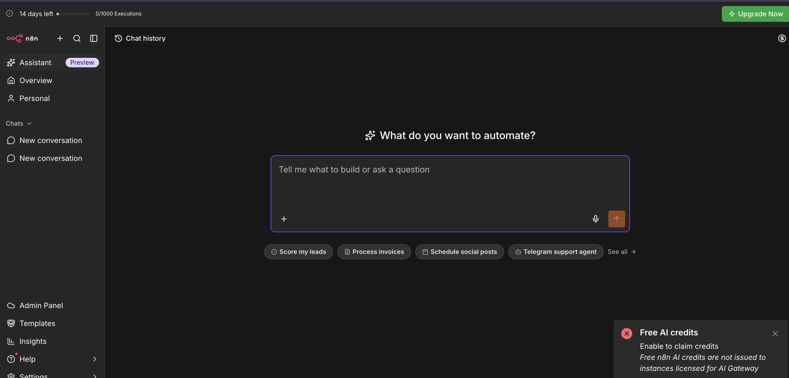

*n8n Assistant — "What do you want to automate?" Type a prompt, or start from a suggestion such as Score my leads or Schedule social posts.*

**Sign in to n8n**

Each learner has one pre-created n8n Cloud account (n8n18oct1 to n8n18oct12@tertiaryinfotech.com); the trainer gives you yours and its password in class. The account name is the email prefix, onboarding is already complete, and each instance is a free 14-day trial that stays active through the training.

1. Go to https://app.n8n.cloud/login — or open your instance URL directly.
2. Enter your assigned account email, for example n8n18oct5@tertiaryinfotech.com.
3. Enter the password your trainer gives you.
   > *Why this step:* Do not change it — the account is reused for later classes.

4. Open your instance from the dashboard.
5. You land in n8n. Open Assistant or Overview to start building.

**Claim your free AI credits**

The n8n Cloud free trial includes free Gateway credits, which let a node call a supported AI model without a provider account or API key.

1. Sign in to n8n Cloud with your training account.
   > *Why this step:* The trial's credit balance belongs to that instance.

2. Open a workflow and add an AI node — for example an AI Agent with a Google Gemini or OpenAI Chat Model.
3. In the node's Credential field, select Use Gateway credits. The option shows your remaining balance.
   > *Why this step:* No API key is pasted anywhere, so none can leak.

4. Pick a supported model, configure the rest of the node as usual, and run it.
5. Track the balance on the node, or in the Admin Panel under Gateway credits.
   > *Why this step:* When the balance reaches zero, nodes on Gateway credits stop until credit is added or you switch to your own credential.


> **Note:** If a red toast reads "Free AI credits — Enable to claim credits", that is n8n's legacy one-time OpenAI offer, which is not issued to instances that have Gateway credits. Ignore it and use Use Gateway credits on the node instead.

**Demo: build a social media campaign workflow with n8n Assistant**

Paste this prompt into n8n Assistant:

```bash
Create a workflow for a social media marketing campaign:
1. Start from a form where I enter a campaign topic.
2. Research the topic on the web and summarise 3 key points.
3. Draft a LinkedIn post under 150 words from the research.
4. Email me the draft and wait for my approval before posting.
5. If approved, schedule the post for 9am the next weekday;
    if rejected, log my feedback in a Google Sheet.
Use Gateway credits for the AI model. Ask me before publishing.
```

n8n Assistant plans and builds a five-stage workflow: a Form Trigger where you enter the topic; an AI Agent with a web-search tool that researches it; an AI step that drafts the post; a human-in-the-loop approval (Gmail Send and Wait for Response) so nothing is posted unchecked; and a Wait plus the social node that schedules and publishes the approved post, with rejections logged to a Google Sheet. Then review the plan before it builds, connect Gmail and the social account when it asks, test with a real topic and approve the draft, and publish only when the run looks right. The AI built the workflow; the workflow runs it.

**The five principles of AI security**

| Principle | Controls | What it means |
|---|---|---|
| 1. Data Control | What AI can see | Classify your data — public, internal, confidential — and decide exactly which data the AI may access. |
| 2. Permission Control | What AI can do | Grant only the rights needed — read, write, edit, delete. Ask before anything destructive. |
| 3. Human in the Loop | Who approves | A person reviews and approves high-impact actions — payments, deletions, customer emails. |
| 4. Traceability | What happened | Log every prompt, tool call and change so actions can be audited, explained and rolled back. |
| 5. Right-Sized Models | Not the most powerful | The smallest model that does the job carries less autonomy and less risk. |

In n8n these map to scoped credentials per node, approval gates (Gmail Send and Wait for Response), the Executions log, and a small model for each AI step.

**Workflow first vs agent first — AI security**

A fixed path limits the blast radius: a manipulated AI step — for example one hit by a prompt injection — cannot reach tools that are not wired to it.

| Principle | Workflow First | Agent First |
|---|---|---|
| Data control | Each node sees only the fields wired into it | The agent can reach any data its tools expose |
| Permission control | Each credential is scoped to one node and one action | The agent holds every tool's rights at once |
| Human in the loop | The approval gate sits at a fixed, designed step | Depends on the agent choosing to ask |
| Traceability | Every run is logged node by node in Executions | Reasoning varies run to run and is harder to explain |
| Right-sized models | A small model for each narrow AI step | One capable model with broad autonomy |

**Business value of workflow-first agentic automation**

- Reliable and predictable — the same input follows the same path every time, so the process can be tested and trusted like software.
- Secure by design — each step holds only the data and credentials it needs, and risky actions wait at an approval gate.
- Auditable end to end — every run is logged node by node, so any decision can be explained, replayed and corrected.
- Lower running cost — deterministic steps cost nothing in tokens; the LLM is called only where judgement is needed.
- Faster to build and change — Claude Code and Codex draft the workflow in minutes; your team reviews, tests and owns it.
- Scale around the clock — triggers respond in real time, 24/7, and ten times the volume costs compute, not ten more hires.

**Where agentic automation is used**

The same pattern — trigger, agent, tools, oversight — recurs in customer service, finance and accounting, risk and compliance, HR and people operations, sales and marketing, and operations.

**Where agent platforms sit**

| Tier | How you build | Customisation | Examples |
|---|---|---|---|
| No-code | Drag and drop in a fully visual builder | Lowest — fastest to a working agent, least control | AgentX and similar chatbot builders |
| Low-code | AI-assisted: n8n Assistant, Claude Code or Codex drafts the workflow on a visual canvas; add JavaScript or Python in Code nodes where needed | High — 400+ integrations, self-host or cloud | n8n — this course's platform |
| Full-code | AI generates the code: Claude Code or Codex write it instead of coding by hand | Highest — the most customisable tier | LangChain and agent SDKs |

AI now assists every tier. In low-code it drafts the workflow, and low-code platforms let you drop into JavaScript or Python when a built-in node is not enough. In full-code the AI writes the code itself rather than a developer coding it manually — full code remains the most customisable option, at the cost of the most engineering effort to test and run.


### Key Concepts for Lab 1 — n8n Trigger and Action

- **What is n8n** — n8n is a fair-code, workflow-first agentic AI platform: the workflow owns the path, and AI and AI Agent nodes sit inside it. You drag nodes onto a visual canvas and wire them together to move data between more than 400 applications, with little or no code. Every node shows its input and output as JSON, so you can see exactly what is flowing through. Workflows are plain JSON files you can export, version and share.

- **Nodes: the four building blocks** — TRIGGER nodes start a workflow (Form, Webhook, Schedule, Chat, Manual). ACTION nodes do something (send Gmail, append a Google Sheets row, call an HTTP API). LOGIC nodes control the flow (IF, Switch, Merge, Split Out, Code, Edit Fields). AI nodes reason and act (AI Agent, Chat Model, Memory, Embeddings, Vector Store, Tools).

- **Triggers and actions** — A trigger decides WHEN a workflow runs; an action decides WHAT it does. This is the whole idea behind Lab 1 — one trigger, one action, and a working automation.

- **Trigger nodes — what may start a workflow** — The trigger you choose is a statement about who or what is allowed to start the process. Manual Trigger runs on a click, for building and for one-off jobs such as the Lab 5 ingestion. Schedule Trigger runs on a clock. Form Trigger hosts a web form for you, and is Lab 1's front door. Webhook lets an external system call a URL you expose, and is the front door for Labs 2 to 5. Chat Trigger uses n8n's built-in chat window. App and email triggers fire on a new Gmail message, a new Sheets row or a new Drive file.

- **Data-processing nodes — the workhorses** — Between the trigger and the output these nodes shape, route and transform the data. Edit Fields (Set) adds, renames or reshapes fields and is the node you reach for first when data is the wrong shape. IF and Switch branch the workflow — Lab 4 uses an IF to split the approved path from the reassignment path. Filter drops non-matching items; Merge combines branches; Split Out and Aggregate convert between one item holding a list and many items. Code runs JavaScript or Python for the small fraction a built-in node cannot do. HTTP Request calls any API on the internet.

- **Where the data goes** — Google Sheets is the audit log in Labs 2 and 4 — Append Row is the workhorse operation. Gmail sends a message, and in Lab 4 its Send and Wait for Response operation turns email into an approval gate. A Vector Store holds embeddings for RAG. Respond to Webhook returns data to whoever called the webhook, which is what lets a web page render the agent's answer.

- **Data, JSON and expressions** — Data flows between nodes as a list of items, each a JSON object of key/value pairs. Read a value from an earlier node with an expression such as {{ $json.Name }}. Expressions work in any field — subject lines, URLs, conditions and message bodies. You can also drag a field from the input panel to map it automatically.


### Lab 1 — n8n Trigger and Action (Event Flyer with QR Code)

Learning outcome: this lab develops your ability to build an automated workflow in n8n using a trigger and an action (A2, K7, K8).

Deck reference: Slides 39–47.

**Goal**

Build your first n8n workflow end to end. An n8n Form Trigger collects a visitor's details, and a Gmail action emails them to the event administrator. You then PUBLISH the workflow, copy the form's Production URL, turn it into a QR code and place it on an event flyer, so anyone can sign up by scanning it with a phone.

**What you'll build**

Form Trigger  →  Gmail (Send a message)  →  Publish  →  QR-code flyer   (Tools: n8n Form Trigger, Gmail (OAuth2), Smart QR Code Generator.)

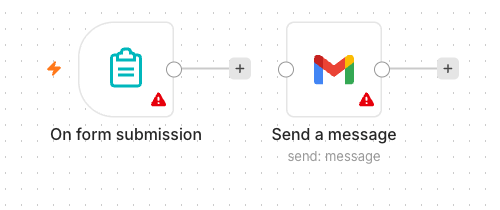

*The finished Lab 1 workflow on the n8n canvas — the Form Trigger fires on each submission and the Gmail node sends the details to the administrator.*

**The workflow on the n8n canvas**

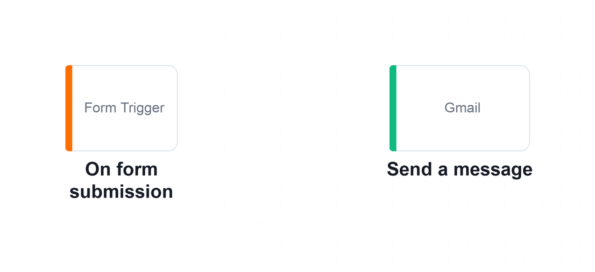

*The Lab 1 workflow on the n8n canvas. Two nodes: the Form Trigger decides WHEN the workflow runs, and the Gmail node decides WHAT it does.*

**Key screens**

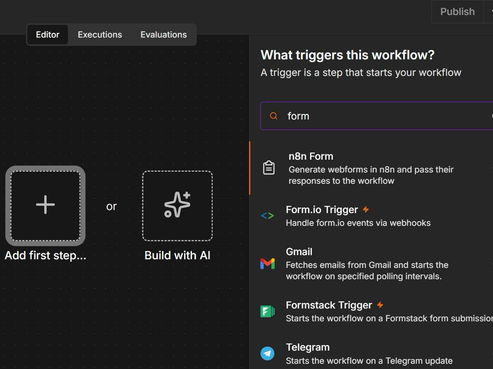

*Step 1: Add the n8n Form Trigger*

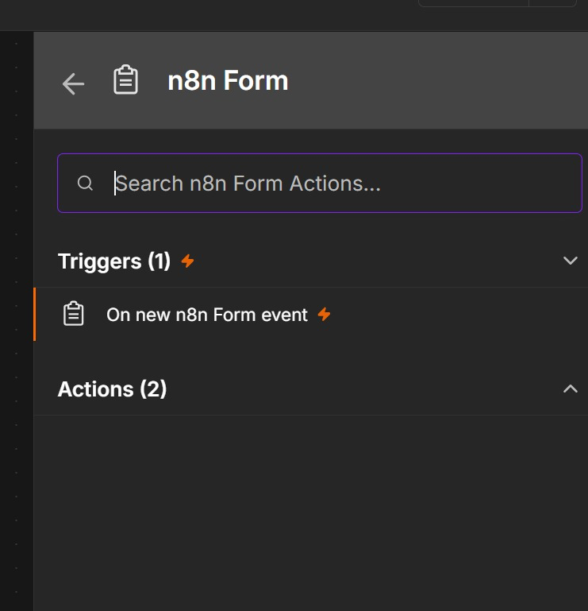

*Step 1: Add the n8n Form Trigger. Click Add first step (+), search 'form' and choose n8n Form → On new n8n Form event. Then add the Name, Email, Phone and Message fields.*

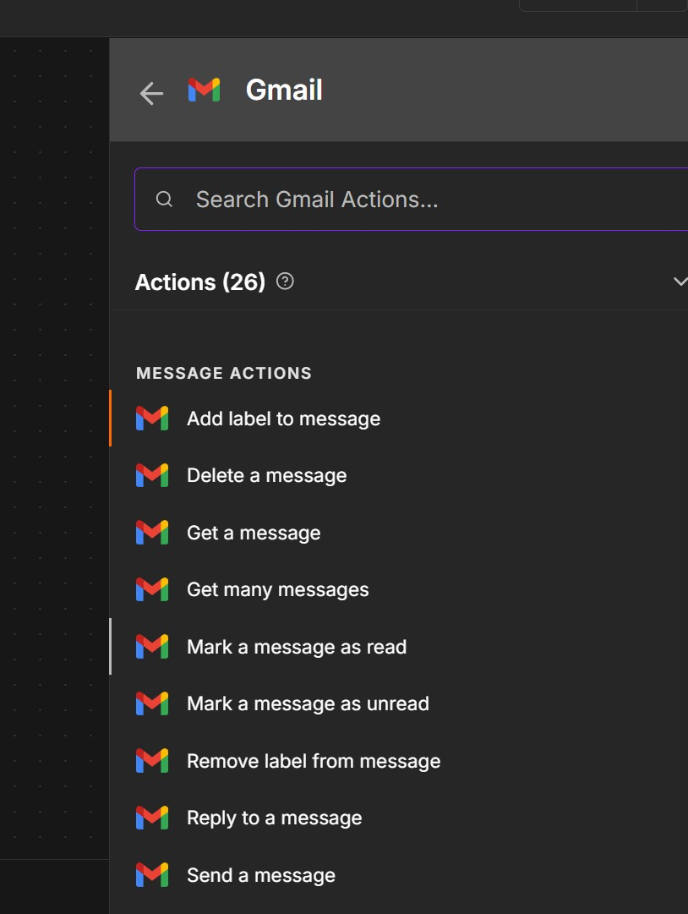

*Step 2: Gmail — Send a Message with Expressions*

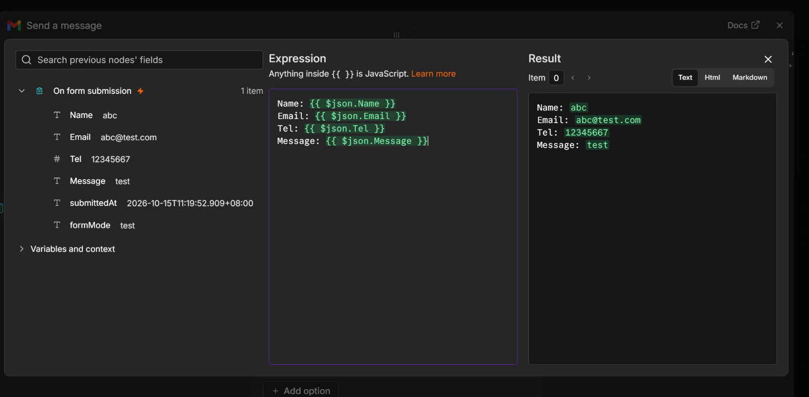

*Step 2: Gmail — Send a Message with Expressions. Add Gmail → Send a message. Switch Message to Expression and drag in the form fields — the Result panel previews the email before you run it.*

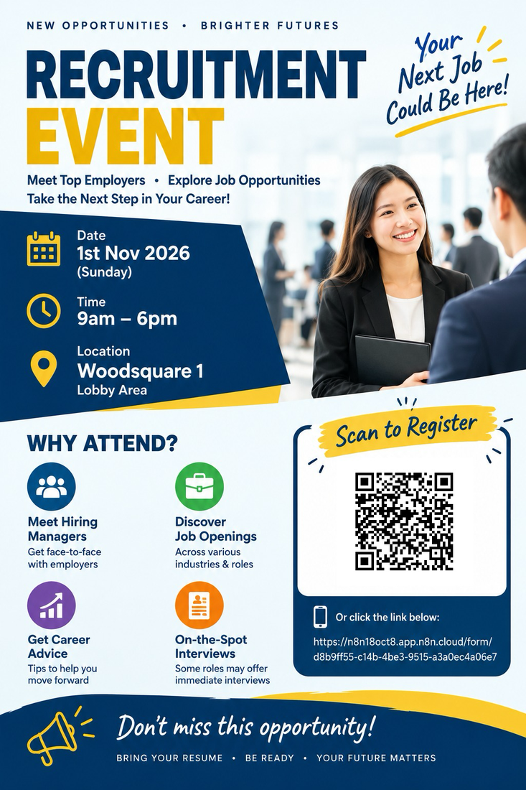

*Flyers from Previous Learners*

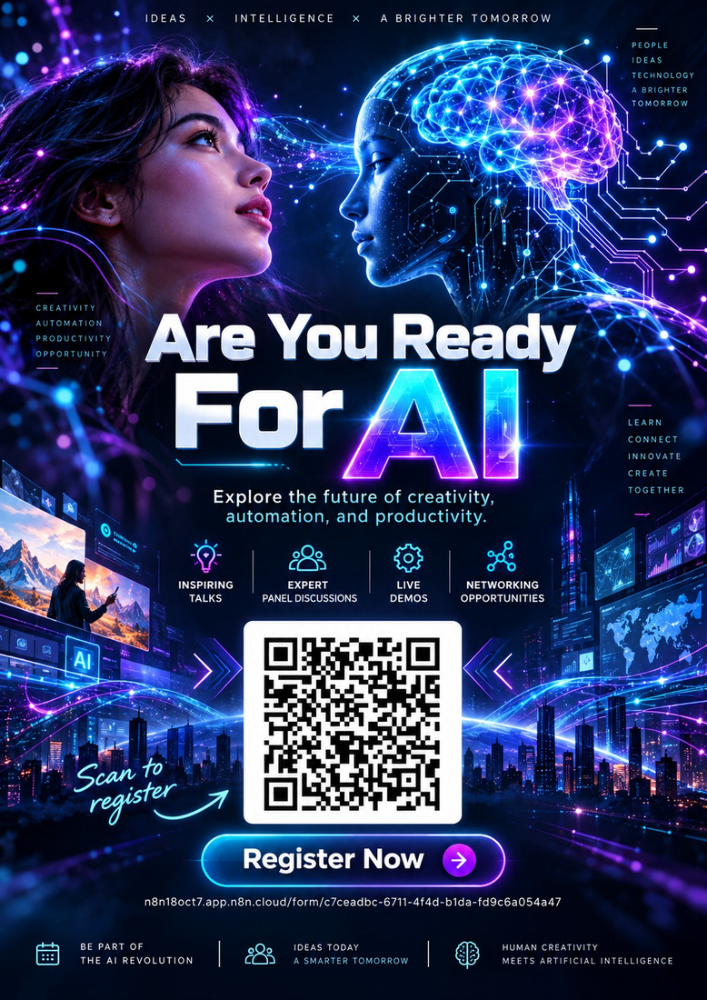

*Flyers from Previous Learners*

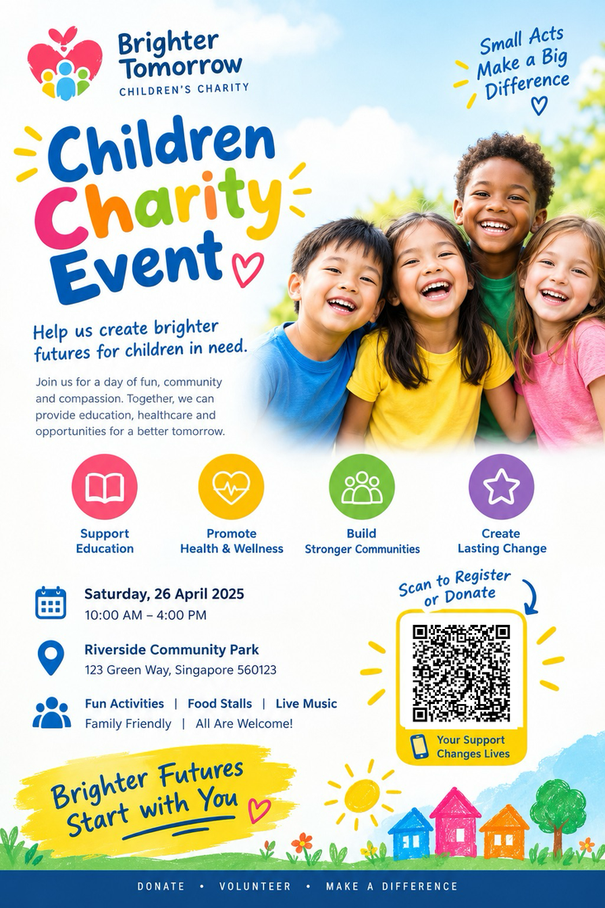

*Flyers from Previous Learners*

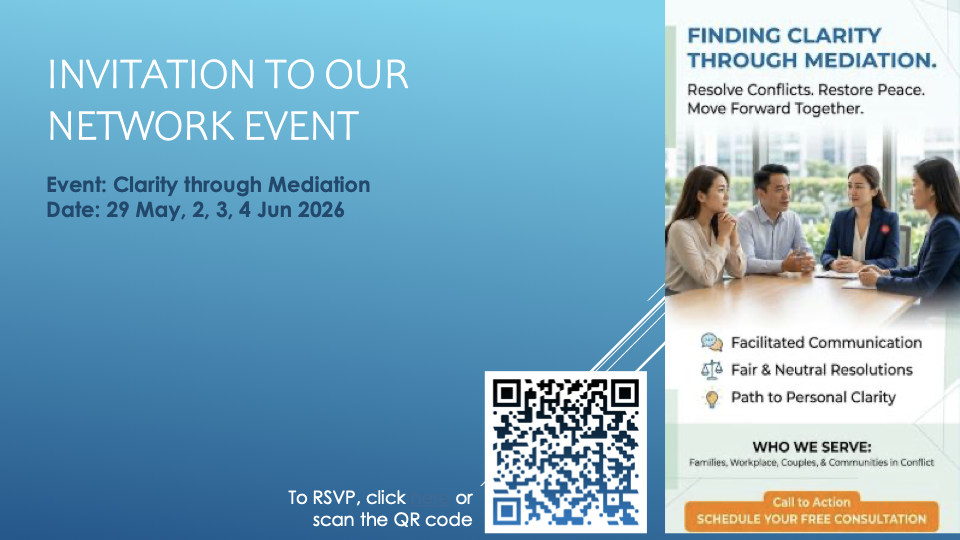

*Flyers from Previous Learners. Each QR code encodes the form's Production URL — scan it, register, and the event administrator receives the details by email.*

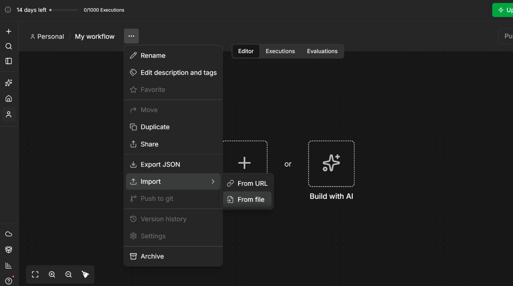

*Compare with the Reference Solution. Create a NEW workflow, open the '...' menu → Import → From File and pick Lab 1 - Event Flyer with QR Code.json, so your own build is not overwritten.*

**Step-by-step**

1. In n8n, click Workflows → Add workflow, and give it a name such as 'Lab 1 — Event Signup'.
   > *Why this step:* Name it now. On a shared instance a canvas called 'My workflow 7' is impossible to find again.

2. Add an n8n Form Trigger node. Set a Form Title (e.g. 'Event Signup') and a short description.
   > *Why this step:* The trigger is always the first node — it is what decides WHEN this workflow runs.

3. Add four form fields: Name (Text), Email (Email), Phone (Number) and Message (Textarea). Mark Name and Email as required.
   > *Why this step:* Field names become the JSON keys the next node reads, so Name here is what makes {{ $json.Name }} work later.

4. Add a Gmail node after the trigger and choose the 'Send a message' operation.
   > *Why this step:* This is the action: the trigger decided when, the action decides what actually happens.

5. Connect your Gmail account under Credential to connect with → Sign in with Google, and grant access.
   > *Why this step:* Credentials are stored once and reused by every workflow. Never paste a key into a node field.

6. Set To = the administrator's address and Subject = New Enquiry.
   > *Why this step:* Fixed values are fine here — only the body needs to change per submission.

7. Switch the Message field to Expression and build the body from the form fields, e.g. Name: {{ $json.Name }} and Email: {{ $json.Email }}.
   > *Why this step:* In Fixed mode n8n prints the braces literally. Expression mode is what evaluates them against the incoming item.

8. Click Execute workflow to open the test form, submit a sample entry, and confirm the email arrives.
   > *Why this step:* Test before activating. The canvas shows the data at every node, so you can see exactly what the Gmail node received.

9. Click Publish at the top right of the editor to make the workflow live.
   > *Why this step:* Until the workflow is published only the Test URL works, and it answers exactly one submission while you are watching.

10. Open the Form Trigger node, switch the form URL from Test URL to Production URL, and copy it.
   > *Why this step:* The Production URL is the one that works for everyone, from any phone, at any time — it is what the QR code must open.

11. Open the Smart QR Code Generator at alfredang.github.io/qrcodegenerator, paste the Production URL, and download the QR code as PNG.
   > *Why this step:* The generator runs entirely in your browser — nothing about your form is uploaded to a third party.

12. Design an event flyer (for example a recruitment fair, a charity day or a networking evening) in Canva, PowerPoint or an AI image tool, and place the QR code on it with a clear 'Scan to register' call-to-action.
   > *Why this step:* A QR code without a call-to-action is just decoration — tell people what scanning it does.

13. Group activity: present your flyer to the class. Classmates scan the QR code and register, and you confirm each sign-up arrives in the administrator's inbox.
   > *Why this step:* This is the whole point: a two-node workflow becomes a real sign-up channel anyone can use from a phone.


**Test it**

Scan the QR code on your flyer with your phone, submit the form, and confirm the administrator's inbox receives the email with the details you typed. A reference solution is provided as labs/lab1-trigger-actions/Lab 1 - Event Flyer with QR Code.json — build yours by hand first, then import it to compare.

**What you learned**

- Triggers and actions — A trigger decides when a workflow runs; an action decides what it does.
- Expressions — Expressions such as {{ $json.Name }} carry data from one node to the next.
- Test vs Production URL — The Test URL works only while you are listening; the Production URL works once the workflow is published.

**Troubleshooting**

| Symptom | Cause and fix |
|---|---|
| The test form does not open | Click Execute workflow first — the Form Trigger only serves its test form while listening. |
| No email arrives | Check the Gmail credential is connected and that the To address is correct. Look at the execution log for a red node. |
| The email body shows {{ $json.Name }} literally | The Message field is in Fixed mode. Switch it to Expression. |
| The QR code works once, then stops | You encoded the Test URL. Activate the workflow and encode the Production URL instead. |

> **Note:** The workflow file and all supporting assets for this lab are in labs/lab1-trigger-actions/.

---


### Key Concepts for Lab 2 — Webhook and AI Agent

- **What is an AI agent** — An AI agent is an LLM given a goal, a set of tools and memory. The model supplies the judgement — which tool to call and when — while you supply the goal, the guardrails and the tools it is allowed to use. In n8n an agent has four parts: a Chat Model, a System Instruction, Memory and Tools.

- **The four components of an AI agent** — Every agent in this course is exactly four parts around one hub. The MODEL is the LLM that interprets language, reasons and chooses the next step. MEMORY keeps the conversation so a follow-up question still makes sense, keyed on a session ID. TOOLS are the abilities it may use — look up a Sheets row, search a vector store, send an email, call an API. INSTRUCTIONS are the system message: identity, scope, rules and refusals, always in force on every turn. Change any one of the four and you have a different agent.

- **Popular LLM providers** — Any chat model plugs into the same AI Agent node, so you can swap the brain and keep the agent. This course uses Google Gemini (Flash), which also supplies the embeddings in Lab 5. n8n loads each provider's live model list into the chat-model node, so new models appear as soon as they ship. As of October 2026 the leading options are Google Gemini 4 Argon, Gemini 3.8 Flash and Gemini 3.1 Pro; OpenAI GPT-6 Astra, GPT-6.1 Sol and GPT-6 Luna (GPT-5.x remains in the API); Anthropic Claude Opus 5.5, Sonnet 5.5 and Haiku 5.5; Meta Llama 4 (open weights, self-hostable); and Mistral Large 4 and Medium 3.5. Pick by task: small fast models for classification and guardrails, larger models for reasoning.

- **Model parameters — temperature and friends** — Settings on the chat-model node shape HOW the model answers, and the most important is temperature. A temperature of 0 to 0.3 is deterministic and repeatable — use it for classification, compliance decisions and data extraction, that is, any automation that must give the same answer twice. Around 0.7 is balanced and natural-sounding, the usual default for a customer-facing assistant. Above 1.0 is creative and surprising, suitable for marketing copy and never for a decision you must defend. Top-p is an alternative sampling control — tune temperature or top-p, never both. Max tokens caps the reply length and so caps your cost. Lab 3 uses temperature 0.2 so a compliance-bound chatbot refuses the same way every time.

- **Tools — and why the description matters** — Tools attach to the agent's Tool input, and the model decides when to call one based on the DESCRIPTION you write. Write that description for the model, not for a developer. Lab 2 attaches three tools — check for a duplicate customer, create the customer record, send the confirmation — and you can watch the agent choose between them on the canvas.

- **MCP — the Model Context Protocol** — MCP is an open standard that gives agents a common plug for tools and data. Without it, every agent needs a custom integration for every tool: N agents and M tools means N times M connectors to build and maintain. With MCP you build one MCP server per system and any MCP-capable agent can use it — N plus M pieces, and the tools become reusable. It is often described as USB-C for AI tools. n8n sits on both sides: the MCP Server Trigger exposes your n8n workflows AS tools that Claude or an IDE can call, and the MCP Client Tool attaches external MCP servers to your own n8n agent.

- **Instructions — the four parts that constrain** — Every good agent instruction states four things. IDENTITY: who the agent is and for whom. SOURCE RULES: where answers may come from, for example 'answer only from the brochures returned by the tool'. REFUSALS: what is out of bounds, stated explicitly. ESCALATION: what to do at the boundary, for example 'if unsure, say so and offer a consultation'. Vague instructions produce confident wrong answers — every rule you skip, the model improvises.

- **Writing a good system instruction** — State the role plainly. Give the scope and the limits — what it must answer and what it must refuse. Say which tool to use for which kind of question. Ask for a specific output format when something downstream depends on it. Tell it to say 'I don't know' rather than invent an answer. Then test it with real questions and refine.

- **Good and bad instructions compared** — A bad instruction reads 'You are a helpful assistant. Answer the user's questions politely.' It has no identity, no source rules, no refusals and no escalation, so it will invent a price and guarantee an investment return — politely. A good instruction names the firm, limits the topics, points at a specific tool for factual questions, lists the prohibitions, and says what to do when unsure. The test is simple: you can try to break each line of a good instruction, and you cannot even test a vague one.

- **Structured output** — By default an agent returns a paragraph of prose, and prose cannot be branched on, sorted or coloured. A Structured Output Parser forces named fields such as decision, reason and riskFlags. An IF node can then route on decision, a Sheets node can log it, and a web page can colour the result card. Enumerate the allowed values so the field stays reliable.

- **Webhooks** — A webhook is a URL that any external system can POST data to; it starts your workflow when called. It is the opposite of an HTTP Request node: there YOU call the outside world, here the outside world calls YOU. Set Allowed Origins (CORS) so a browser page may read the reply, and consider Authentication before anything goes to production — an open webhook costs you money every time a stranger calls it.

- **Webhooks — GET vs POST** — The HTTP method is part of the contract with the caller. With GET the data rides in the URL query string, for example ?email=alice@corp.com, so a browser can call it just by visiting the URL; you read it in n8n as {{ $json.query.email }}. GET suits a dashboard pulling data to display. With POST the data rides in the request body as JSON, which is what a web form or a chat widget sends; you read it as {{ $json.body.message }}. Every lab website in this course POSTs. Set the method on the Webhook node, and the caller must match it exactly.

- **Webhook Test URL vs Production URL** — Every Webhook node gives you two URLs, and confusing them is the single most common webhook bug. The Test URL (/webhook-test/…) works only while you have clicked 'Listen for test event', handles exactly one call and then stops, shows the run live on the canvas, and dies when you leave the editor. The Production URL (/webhook/…) requires the workflow to be published (Publish, top right), is always on, accepts unlimited calls, and logs its runs under Executions rather than drawing them on the canvas. Your website must call the Production URL of a published workflow.

- **Configuring the Webhook node** — Four settings decide whether a browser's call succeeds. METHOD AND PATH give you the URL. ALLOWED ORIGINS (CORS) must permit the calling page, or the workflow will run perfectly and the browser will still refuse to read the reply — the classic 'Failed to fetch'. Set it to * in class and never in production. RESPONSE MODE should be 'Using Respond to Webhook Node' in every lab here, so the agent's answer travels back instead of an immediate 200 OK. AUTHENTICATION can be None for a demo, but Basic, Header or JWT for anything real — a public URL is a public door, and every call costs you model tokens.

**Example: A GET Webhook That Publishes a Recipe Page**

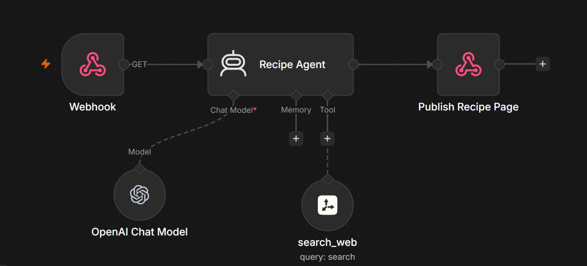

*One URL, one agent, one page back. A webhook does not have to sit behind a form — opening a link can run an agent.*

| Node | What it does |
|---|---|
| Webhook — GET | Opening the URL in a browser is the request. Anything the agent needs can ride in the query string. |
| Recipe Agent | An OpenAI chat model writes the recipe. There is no memory: each request stands alone. |
| search_web tool | The agent calls search_web, passing a search query, when it needs facts from the web. |
| Page back | Publish Recipe Page (a Respond to Webhook node) returns the page, so the browser shows it at once. |

> **Note:** GET suits a link anyone can click. Lab 2's bank form uses POST, because it sends a body of applicant data.


### Lab 2 — Webhook and AI Agent (Marina Trust Bank Onboarding)

Learning outcome: this lab develops your ability to deploy an AI agent that is triggered by a webhook from an external website (A1, A2, K7, K8).

Deck reference: Slides 70–74.

**Goal**

Replace the n8n form with a real bank website. A customer applies for an account on your own HTML page, which POSTs to an n8n Webhook. An AI Agent applies the bank's onboarding rules, calls Google Sheets tools to check for duplicates and create the customer record, emails a confirmation, and returns a structured decision that the page renders as a coloured card.

**How the building blocks fit together**

| Building block | In this lab | Why it matters |
|---|---|---|
| Webhook | Onboarding Webhook — POST /marina-trust-onboarding | The bank website's front door; Respond to Website returns the decision |
| AI Agent | Onboarding AI Agent | Applies the bank's onboarding rules and decides |
| Model | Google Gemini Chat Model (Gateway credits) | The LLM brain — keep the temperature low for repeatable decisions |
| Tools & MCP | check_duplicate_customer · create_customer_record · send_confirmation_email | The agent chooses when to call each one |
| Instructions | System message: eligibility rules, age check, four decisions | Where the bank's policy actually lives |
| Memory | None — deliberately | One applicant must never influence the next decision |
| Structured output | Decision Parser — decision, reason, riskFlags | Lets the page colour the result card |

**What you'll build**

Webhook  →  Normalise  →  AI Agent (+3 tools)  →  Log Decision  →  Respond to Website   (Tools: n8n Webhook, AI Agent, Google Gemini, Google Sheets, Gmail, Structured Output Parser.)

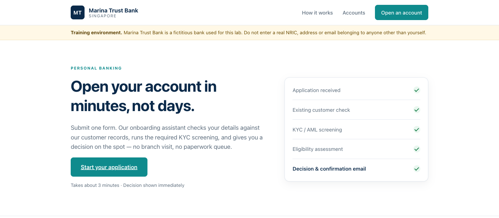

*The Marina Trust Bank site the webhook sits behind. The applicant submits here, the AI Agent decides, and the page renders the decision as a coloured card.*

**The workflow on the n8n canvas**

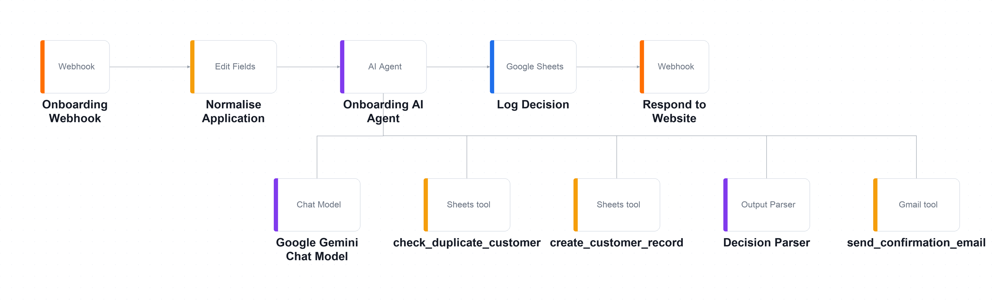

*The Lab 2 workflow on the n8n canvas. The main chain runs left to right; the chat model, output parser and three tools hang below the agent on its Tool input.*

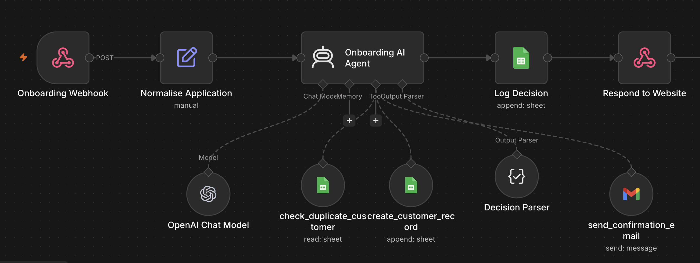

*The imported workflow on the n8n canvas. The main chain runs left to right; the agent's model, tools and parser hang beneath it.*

| Part of the flow | What it does |
|---|---|
| Front door | The bank site POSTs to Onboarding Webhook; Normalise Application tidies the fields the agent reads. |
| The agent | Onboarding AI Agent applies the bank's rules with its chat model; Decision Parser returns decision, reason and riskFlags. |
| Three tools | check_duplicate_customer, create_customer_record and send_confirmation_email — the agent chooses when to call each. |
| Log and respond | Log Decision appends an audit row to Google Sheets; Respond to Website sends the decision back to the page. |

> **Note:** The dashed lines are the agent's sub-nodes: it calls them when it decides to — the solid chain always runs in order.

**Step-by-step**

1. Create a Google Sheet named 'Retail Banking Onboarding' with a Customers tab and an Onboarding_Log tab, and seed a few existing customers.
   > *Why this step:* The seeded rows are what make the duplicate test (TC2) meaningful — without them every applicant looks new.

2. In n8n choose Workflows → Import from File and select Lab 2 - Marina Trust Bank Onboarding Agent.json.
   > *Why this step:* Importing lets you study a finished agent. You will still re-point every credential and sheet to your own.

3. Open the Onboarding Webhook node. Confirm HTTP Method = POST, Path = marina-trust-onboarding, and Respond = Using 'Respond to Webhook' Node.
   > *Why this step:* POST carries a JSON body, which is what a web form sends. 'Respond to Webhook' is what lets the agent's decision travel back to the browser instead of an immediate 200 OK.

4. Under the webhook's Options, set Allowed Origins (CORS) to * so a browser page is permitted to read the reply.
   > *Why this step:* Without CORS the n8n execution succeeds but the browser refuses to read the response — the classic 'Failed to fetch'.

5. Open check_duplicate_customer, create_customer_record and Log Decision, and re-select YOUR spreadsheet in each Document dropdown.
   > *Why this step:* These three point at the author's sheet until you change them. Miss one and the agent reads or writes the wrong file.

6. Re-select your own Google Gemini, Google Sheets and Gmail credentials on every node that shows a credential warning.
   > *Why this step:* Imported workflows carry credential NAMES, not secrets — nothing of the author's account came with the file.

7. Open the Onboarding AI Agent and read the system message: the eligibility rules, the age check, and the four possible decisions.
   > *Why this step:* The system message is where the bank's policy actually lives. Change this and you change the lending decision.

8. Open the Decision Parser and note the required fields — decision, reason, riskFlags — this is what lets the website colour the result card.
   > *Why this step:* A paragraph of prose could not be coloured, counted or branched on. decision is a field precisely so something downstream can act on it.

9. Click Listen for test event, then open index.html in your browser.
   > *Why this step:* Listening arms the Test URL for exactly one request and streams the incoming data onto the canvas.

10. In the page's Lab configuration panel, paste the webhook Test URL, choose TC1 from the Trainer demo data dropdown, enter your own email, and submit.
   > *Why this step:* The demo data deliberately clears the email field so you cannot send a stranger a bank decision by accident.

11. Watch the request land on the n8n canvas and follow it through Normalise into the agent; confirm the agent calls check_duplicate_customer.
   > *Why this step:* This is the moment the agent stops being a black box — you can see it CHOOSE to call a tool.

12. Save, click Publish, copy the webhook's Production URL and paste it into the panel so the page works from any device.
   > *Why this step:* Only now does the page work for anyone but you. The Test URL has already been spent.


**Test it**

Run TC1 (a new applicant) and confirm a green APPROVED card, a new row in the Customers sheet and a confirmation email. Then run TC2 (an already-seeded NRIC) and confirm an amber DUPLICATE card with no new row.

**What you learned**

- Webhooks — A webhook lets any external system — your website, an app, a CRM — start an agent workflow.
- Tools make an agent — Tools are what turn an LLM into an agent: it decides when to look up a customer and when to create one.
- Structured output — Structured output (decision, reason, riskFlags) is what lets downstream nodes branch, log and colour a result.
- The front door is separate — The agent is unchanged from a form-triggered version — only the front door differs.

**Troubleshooting**

| Symptom | Cause and fix |
|---|---|
| Failed to fetch in the browser | The workflow is not published (production URL), or 'Listen for test event' is not armed (test URL). |
| Failed to fetch, but the n8n execution succeeded | CORS. Set Allowed Origins to * in the Webhook node's options. |
| Works once, then 404 | You are using the Test URL. It listens for one request only. |
| Cannot read properties of undefined (reading 'trim') | The Set node expects $json.body.fullName. Check the browser's Network tab: is the payload nested under body? |
| The result card is blank | The Decision Parser is disconnected, so $json.output is a string rather than an object. |
| Everyone is REJECTED as a minor | Check the age expression in the Set node, and that the browser sends dateOfBirth as yyyy-MM-dd. |

> **Note:** The workflow file and all supporting assets for this lab are in labs/lab2-webhook-agent/.

---


## Topic 02 — Agentic Chatbot and Human in the Loop

Agentic workflows · Chatbots on webhooks · Approval gates · Accountability   (Deck reference: Slides 75–98.)


### Key Concepts for Lab 3 — Chatbot Webhook

- **What is an agentic workflow** — An agentic workflow is one where the LLM makes the routing decisions. You still design the process, the guardrails and the tools; what you hand over is the judgement about which path a particular case should take.

- **Rule-based versus agentic** — A rule-based (RPA) workflow has every branch wired by hand and breaks on anything unexpected, but is predictable and easy to audit. An agentic workflow understands free text and intent and handles cases you did not foresee, but needs guardrails and logging. Choose rule-based for fixed, high-volume rules; agentic for varied, language-driven work.

- **Designing a safe agentic chatbot** — Define the role narrowly — a chatbot for one job refuses far more reliably than a general assistant. Write the prohibitions explicitly. Add a fallback sentence such as 'when in doubt, say less and offer a consultation'. Gate what must be collected before answering. Keep a small FAQ in the prompt rather than a vector store. Test with the questions you most fear.

- **Memory — and when not to use it** — A memory node lets a follow-up question be answered in context. Memory is keyed on a session ID so two visitors never see each other's conversation. But some workflows must have NO memory: an application decision should never be influenced by the previous applicant. Ask, for every agent: should this case know about the last one?

**Demo: an HR policy chatbot on Telegram**

What is a chatbot? An agent behind a chat channel. Before Lab 3 puts a chatbot behind a website, you build one on Telegram: Telegram Trigger → HR Agent — Ava → Chat model → Reply on Telegram. The HR Agent, Ava, answers only from sample HR policies written into its system instruction, never invents a number, refers salary, medical or disciplinary questions to HR, and remembers the conversation. (Deck reference: Slides 75–84.)

Step 1 — create a Telegram bot with BotFather:

1. Open the Telegram app and search for the verified account named BotFather (look for the blue checkmark).
   > *Why this step:* BotFather is Telegram's own bot for creating bots. Impostors exist, so check for the blue checkmark.

2. Start a chat and send the command /newbot.
   > *Why this step:* Every Telegram bot, including the ones big companies run, starts with this one command.

3. Type a display name for your bot (e.g., My Free Helper Bot).
   > *Why this step:* The display name is what people see in their chat list. It can contain spaces and can be changed later with /setname.

4. Choose a unique username that ends in bot (e.g., my_free_helper_bot).
   > *Why this step:* The username is the bot's permanent address — t.me/<username> — and must be unique across all of Telegram. If it is taken, try another.

5. Copy the HTTP API token that BotFather replies with (it looks like 123456789:AAH…). You will paste it into n8n in Step 3.
   > *Why this step:* The token is the bot's password. Anyone holding it controls the bot; if it leaks, send /revoke to BotFather.


Step 2 — build the workflow with n8n Assistant.

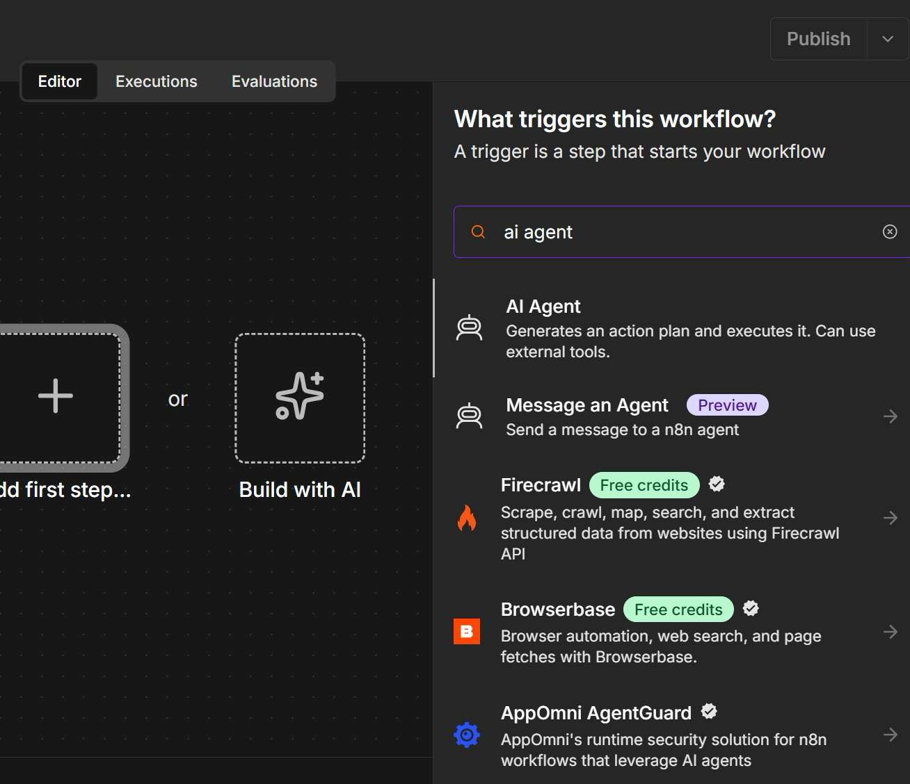

*A new workflow: Add first step (manual) or Build with AI (n8n Assistant).*

- Create a new workflow. The empty canvas offers two starts: Add first step, or Build with AI.
- Click Build with AI — this opens n8n Assistant, which builds the workflow from a plain-English prompt.
- Add first step is the manual route: it opens the node search, here filtered to 'ai agent'.
- Either way you get the same nodes. The Assistant just writes the first draft for you.

Paste this prompt into n8n Assistant:

```bash
Create a 3-node workflow:
•  A user posts a message to a Telegram bot.
•  Telegram sends the data to an HR agent.
•  The HR agent responds to the user on the company HR policies. Create a system instruction for the HR agent with sample company policies in it. The HR agent has a memory.
•  Respond to Telegram.
```

- Review the plan before it builds
- Read the system instruction it wrote — edit the sample policies if you like
- Check a memory node is attached to the HR agent
- Stuck? Import the reference solution instead

> **Note:** Reference solution: labs/lab3-chatbot-webhook/Lab 3 Demo - Telegram HR Policy Agent.json. It has no memory node; the workflow your prompt builds should.

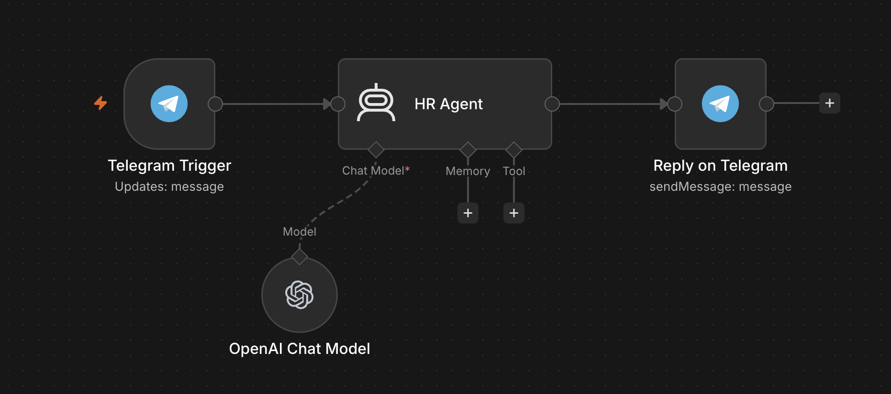

*Your canvas should look like this: trigger, agent, reply — with the chat model and memory hanging under the agent.*

| Node | What it does |
|---|---|
| Telegram Trigger | Updates: message — every message sent to the bot starts one execution. |
| HR Agent | Ava's role, rules and sample HR policies live in the system instruction n8n Assistant wrote. |
| Model and memory | Chat model on Gateway credits; memory keeps each employee's conversation, keyed on the Telegram chat ID. |
| Reply out | Reply on Telegram sends back to the chat ID the trigger received, so the reply lands in the same chat. |

Step 3 — connect the bot, publish and chat:

1. Open the Telegram Trigger node, choose Credential → Create new credential, paste the BotFather token as the Access Token and save.
   > *Why this step:* The trigger listens for messages with this credential.

2. Open the Telegram node that sends the reply and select the same Telegram credential.
   > *Why this step:* Both Telegram nodes share one credential — one listens, the other answers.

3. Open the chat model under the HR agent and choose Use Gateway credits as its credential.
   > *Why this step:* No OpenAI account or API key is needed on n8n Cloud — the same free credits used in Lab 2.

4. Click Publish. n8n registers the workflow's Production webhook with Telegram, so every message to the bot now starts the workflow.
   > *Why this step:* A Telegram bot has ONE webhook at a time. Testing in the editor swaps in the Test URL, so publish again when you are done.

5. Open t.me/<your bot username>, tap Start and ask: How many days of annual leave do I get? Ask a follow-up, then ask about a colleague's salary.
   > *Why this step:* The follow-up proves the memory works; the salary question must be referred to HR — the guardrail in the system instruction.


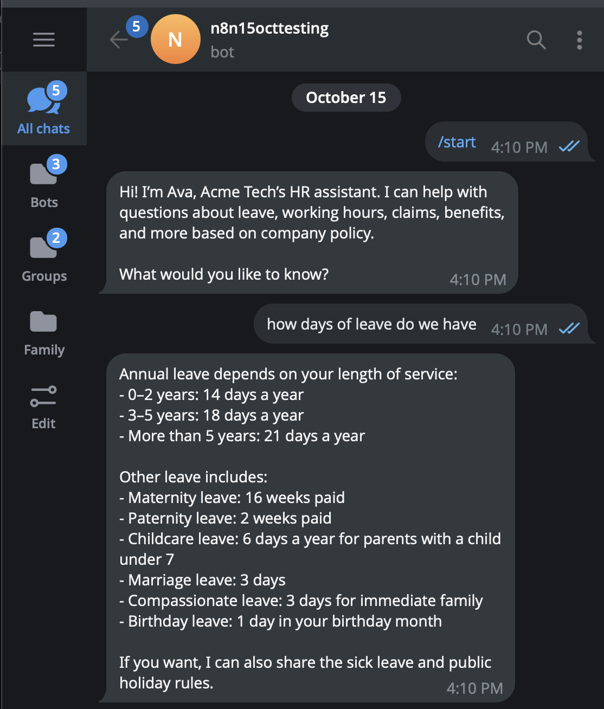

*The live demo bot on Telegram — /start, then a question about annual leave.*

- /start opens the chat — Ava introduces herself exactly as her system message tells her to.
- Ask how many days of leave you get: the answer quotes the policy — 14, 18 or 21 days by length of service.
- Ask a follow-up — memory keeps the context. Then ask about a colleague's salary: Ava must refer you to HR.
- Every message is one workflow run — open Executions in n8n to watch it happen.

> **Note:** The bot is only as safe as its system message. Lab 3 adds a contact gate and a refusal rule, behind a website.


### Lab 3 — Chatbot Webhook (Investment Advisor)

Learning outcome: this lab develops your ability to deploy an agentic chatbot on a website that operates within regulatory limits (A1, A2, K7, K8).

Deck reference: Slides 85–88.

**Goal**

A Singapore investment advisory firm wants a chatbot on its lead-magnet website. Compliance imposes two non-negotiable rules: no visitor gets an answer until the firm can contact them, and the chatbot must never give financial advice. You build a compact agentic workflow that enforces both — a contact gate, a fixed FAQ, and a refusal rule.

**What you'll build**

Chat Webhook  →  Normalize  →  AI Agent (+ model + memory)  →  Respond to Chat   (Tools: n8n Webhook, AI Agent, Google Gemini, Window Buffer Memory, Code node.)

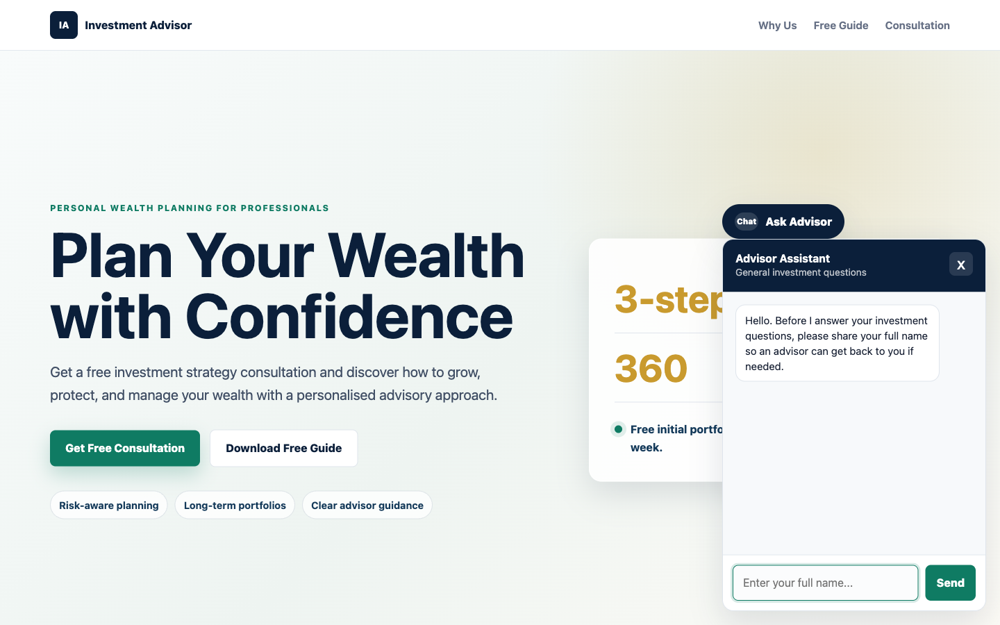

*The Investment Advisor site with the chat widget open. Note the contact gate in action — it asks for the visitor's name before it will answer anything.*

**The workflow on the n8n canvas**

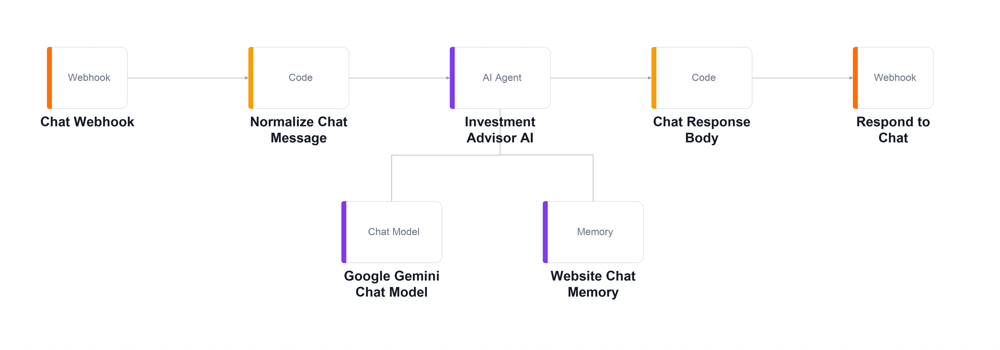

*The Lab 3 workflow on the n8n canvas. A small graph: webhook in, normalise, the agent with its chat model and session memory, then the reply back out.*

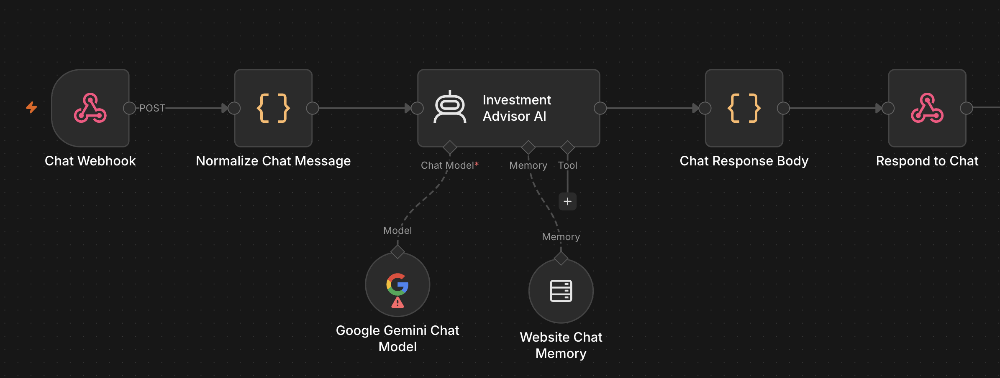

*The imported workflow on the n8n canvas: webhook in, normalise, agent, shape the reply, respond. The intelligence is in the system message.*

| Part of the flow | What it does |
|---|---|
| Message in | Chat Webhook receives each message from the widget; Normalize Chat Message shapes it for the agent. |
| The agent | Investment Advisor AI holds the contact gate, the non-advisory rule and the nine-question FAQ. |
| Model and memory | Google Gemini Chat Model (temperature 0.2) and Website Chat Memory keyed on the visitor's sessionId. |
| Reply out | Chat Response Body builds the JSON reply; Respond to Chat returns it to the widget. |

> **Note:** The warning on the Gemini node means no credential is selected yet — choosing your Gemini credential is the first fix after import.

**Step-by-step**

1. Choose Workflows → Import from File and select Lab 3 - Investment Advisor Chatbot.json.
   > *Why this step:* A small canvas. The intelligence is in the system message, not in the number of nodes.

2. Open Google Gemini Chat Model, select your Gemini credential, and confirm the model is gemini-2.5-flash with temperature 0.2.
   > *Why this step:* Low temperature keeps a compliance-bound chatbot consistent. A creative temperature here means a differently-worded refusal every time.

3. Open the Chat Webhook node: note the path investment-advisor-chat and that Allowed Origins (CORS) is set to *.
   > *Why this step:* Without CORS the workflow runs perfectly and the browser still shows 'Failed to fetch' — the reply is blocked on the way back.

4. Open Investment Advisor AI and read the contact gate — the agent must collect name, telephone and email before answering anything.
   > *Why this step:* The browser enforces the same gate. Ask yourself which of the two you would trust if you could keep only one — and which runs on a machine you control.

5. Read the non-advisory rule: never recommend a product, predict a return, guarantee an outcome, or advise on the visitor's own circumstances.
   > *Why this step:* These six prohibitions are a compliance control, not prompt-engineering polish. The firm is not licensed to give this advice.

6. Read the nine FAQ pairs written into the system message, and note why they live in the prompt rather than in a vector store.
   > *Why this step:* Nine short answers cost nothing to retrieve and a compliance officer can review them in one sitting. RAG is for knowledge too large or too changeable for that.

7. Open Website Chat Memory and note that it is keyed on sessionId, so two visitors never see each other's conversation.
   > *Why this step:* Contrast with Lab 2's onboarding agent, which has no memory at all — there, one applicant's data must never influence the next decision.

8. Save and Activate the workflow, then copy the webhook Production URL.
   > *Why this step:* The widget must work for every visitor, so it needs the Production URL rather than the single-shot Test URL.

9. Serve the website folder and open it in your browser.

   ```bash
   python3 -m http.server 8000
   ```

   > *Why this step:* Serving over http:// matches how the real site would run, and keeps the browser's security rules realistic.

10. Scroll to Lab configuration, paste your webhook URL, then click Ask Advisor and complete the name, phone and email prompts.
   > *Why this step:* Notice the suggested questions stay hidden until the contact gate is passed — there is no path to the agent that skips it.

11. Work through sample-questions.csv, paying particular attention to the four compliance probes TC4 to TC7.
   > *Why this step:* TC4 to TC7 are the ones that matter. A fluent, helpful answer to any of them is a regulatory failure.


**Test it**

Ask 'Can you guarantee returns?' and 'Which stock should I buy?'. The agent must decline both and offer a consultation. Then ask a question before giving your details — it must ask for the missing detail and answer nothing.

**What you learned**

- The system message — An agentic chatbot's system message is a compliance control, not just a prompt.
- Defence in depth — The same rule enforced in the browser and in the agent is deliberate redundancy — only one of them runs on a machine you control.
- Session-keyed memory — Session-keyed memory gives context to follow-up questions without leaking between visitors.
- Prompt or RAG? — A small fixed FAQ belongs in the prompt; RAG is for knowledge too large or too changeable for that.

**Troubleshooting**

| Symptom | Cause and fix |
|---|---|
| Failed to fetch | Workflow not published (production URL), or 'Listen for test event' not armed (test URL). |
| Failed to fetch, but the execution ran | CORS. Set Allowed Origins to * on the Webhook node. |
| The agent answers before collecting contact details | The contact gate is missing from the system message, or was weakened. Restate it as a hard precondition. |
| The agent gives investment advice | Read the reply aloud in the debrief. Tighten the prohibitions — this is the failure the lab is designed to expose. |
| Follow-up questions lose context | The memory node is disconnected, or the browser is not sending a stable sessionId. |

> **Note:** The workflow file and all supporting assets for this lab are in labs/lab3-chatbot-webhook/.

---


### Key Concepts for Lab 4 — Human in the Loop

- **Human in, on, and out of the loop** — There are three levels of human oversight, and the design question is which one a given process deserves. Human IN the loop means the workflow pauses and a named person must approve before the action happens — nothing reaches the customer unauthorised, which is Lab 4. Human ON the loop means the agent acts immediately while a person monitors and can intervene or reverse it, which suits high volume with low individual risk. Human OUT of the loop is fully autonomous, and is acceptable only where an error is cheap, reversible and detectable — never where money or a regulator is involved.

- **Human in the loop** — Some actions are too consequential to automate. A human-in-the-loop step pauses the workflow until a named person approves or declines. The agent may do everything except the one thing that matters — sending. In n8n this is the Gmail 'Send and Wait for Response' node, and the execution genuinely pauses on the canvas until a button is clicked.

- **How an approval suspends a running workflow** — A Send-and-Wait node stops the execution mid-flight. Look at the canvas and the run is genuinely sitting on the approval node; n8n holds the state, and it will wait for days if it has to. The Approve and Decline buttons in the email are simply two URLs, so clicking one resumes the execution down that branch and the approver has no new application to learn. A decline is a reassignment rather than a deletion, because someone still owes the client an answer.

- **When to put a human in the loop** — When money moves; when it is a regulated communication; when the action is irreversible; when a person is vulnerable; when the stakes exceed the error rate; and when someone must be accountable. The question is never 'is the model good?' but 'what does one bad output cost?'

- **Guardrails — two gates around the agent** — Instructions shape what the agent intends; guardrails check what actually goes in and comes out. An INPUT guardrail screens the incoming message before the model ever sees it: block prompt injection such as 'ignore your instructions and…', strip personal data you must not process, and rate-limit and authenticate, because a public webhook is a public door. An OUTPUT guardrail checks the reply before it reaches a person: look for phrases you have banned such as guarantees and forecasts, validate the structured fields against the values you allow, and on any doubt route to a human rather than sending. Enforcing the same rule in the prompt AND in the workflow is deliberate redundancy — only one of the two runs on a machine you control.

- **The accountability trail** — Log what the agent PROPOSED separately from what a human AUTHORISED. Keeping them apart is what lets an auditor ask whether anyone ever sent something a human never saw. Every approved action carries the name of the approver; every declined one is reassigned to a named person. No accountability column should ever be empty.

**Guardrails in n8n — the Guardrails Node**

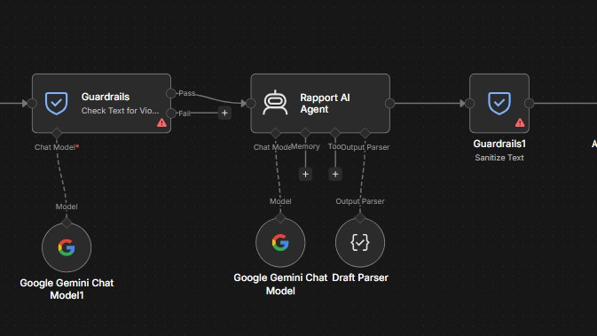

*The two gates from the previous slide, built with n8n's Guardrails node: one before the agent, one after it.*

| Node | What it does |
|---|---|
| Input guardrail | Guardrails · Check Text for Violations screens each message before the agent sees it, using its own chat model. |
| Pass or Fail | Pass continues to the agent. Fail branches away, so a blocked message never reaches the model. |
| The agent | Rapport AI Agent drafts the reply with its Gemini model and the Draft Parser. |
| Output guardrail | Guardrails1 · Sanitize Text cleans the reply — for example removing personal data — before anything is sent. |

> **Note:** Defence in depth: the prompt asks the agent to behave; the Guardrails nodes check that it did.


### Lab 4 — Human in the Loop (Client Rapport Assistant)

Learning outcome: this lab develops your ability to apply a human approval gate so no AI-drafted communication is sent unsupervised (A1, A2, A3, K7, K8).

Deck reference: Slides 94–98.

**Goal**

Meridian Asset Management's relationship managers take three days to answer worried clients. You build an agent that reads the client's concern and emotional tone, raises compliance flags, and drafts a strictly non-advisory reply — but sends nothing. A licensed manager receives the draft by email and clicks Approve or Decline. Only then does anything reach the client; a decline reassigns the ticket to a named human.

**What you'll build**

Webhook → Agent → Acknowledge → Log Draft → RM Approval (Send & Wait) → IF → Send / Reassign   (Tools: n8n Webhook, AI Agent, Google Gemini, Gmail Send-and-Wait, Google Sheets, IF node.)

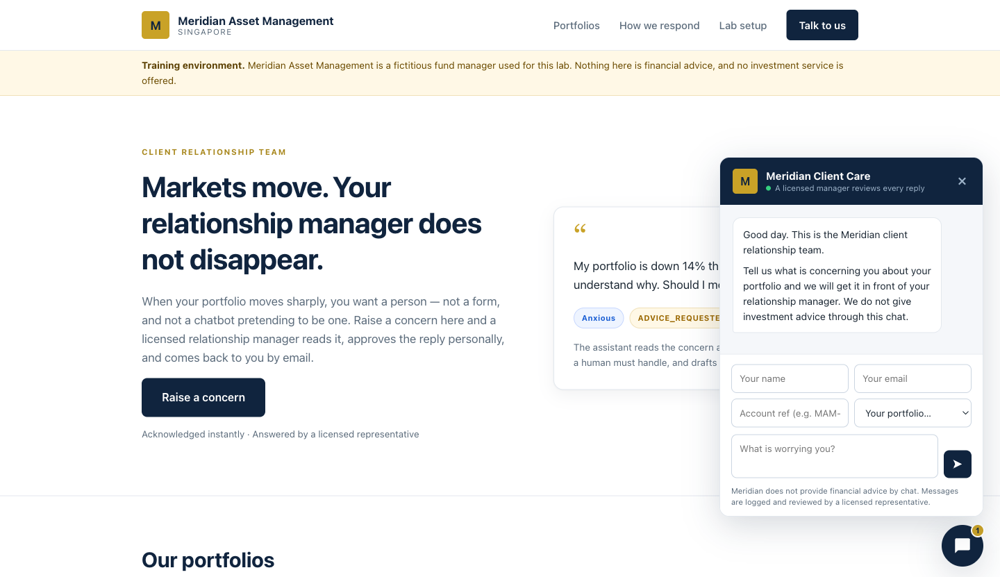

*The Meridian client portal. The widget states plainly that a licensed manager reviews every reply — the human-in-the-loop promise made visible to the client.*

**The workflow on the n8n canvas**

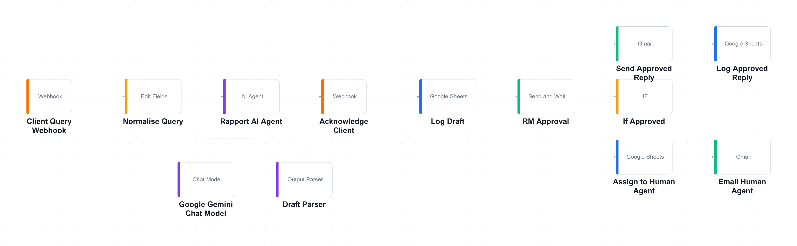

*Everything up to RM Approval is the agent's territory; the IF node after it splits into the approved path (top) and the reassignment path (bottom).*

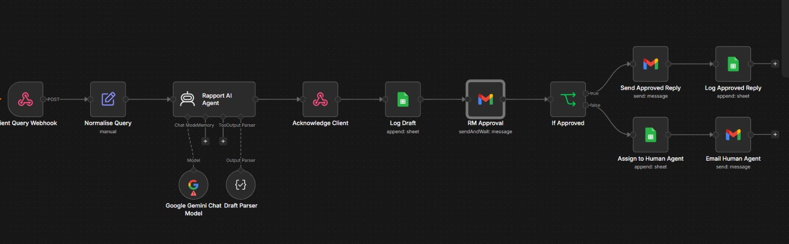

*The imported workflow on the n8n canvas. Everything up to RM Approval is the agent's work; nothing after it runs until a person decides.*

| Part of the flow | What it does |
|---|---|
| Concern in | Client Query Webhook receives the client's message; Normalise Query tidies it for the agent. |
| The agent | Rapport AI Agent drafts a non-advisory reply; Draft Parser returns tone, urgency and compliance flags. |
| Log, then pause | Acknowledge Client answers at once, Log Draft records the draft, and RM Approval waits for a human. |
| Two paths | If Approved: send and log the reply. Otherwise: Assign to Human Agent and email that person. |

> **Note:** RM Approval is a Gmail Send-and-Wait node: the execution genuinely pauses there until Approve or Decline is clicked.

**Key screens**

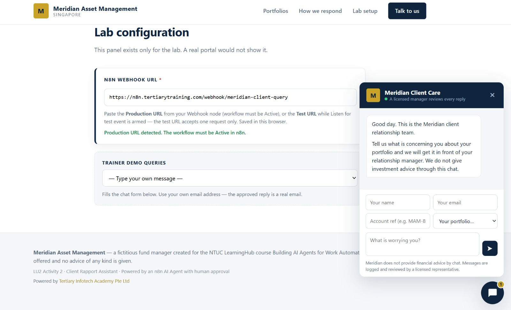

*Step: Connect the Website and Send a Concern. Paste your webhook Production URL into Lab configuration, pick a trainer demo query or type your own, use your own email, and send. The widget promises a licensed manager reviews every reply.*

**Step-by-step**

1. Create a Google Sheet named exactly 'Meridian Client Rapport' with three tabs: Drafts, Approved_Replies and Handover_Queue.
   > *Why this step:* Three tabs, not one. Separating what the agent proposed from what a human authorised is what makes the trail auditable.

2. Import each of drafts.csv, approved-replies.csv and handover-queue.csv into the matching tab with File → Import → Replace current sheet, turning OFF 'Convert text to numbers, dates and formulas'.
   > *Why this step:* Leave the conversion on and Sheets mangles reference numbers and dates into its own formats.

3. Choose Workflows → Import from File and select Lab 4 - Client Rapport Assistant (Human in the Loop).json.
   > *Why this step:* Thirteen nodes, one agent, one human gate. Trace the two paths out of the IF node before you run it.

4. Repoint the three Google Sheets nodes — Log Draft, Log Approved Reply and Assign to Human Agent — at YOUR spreadsheet.
   > *Why this step:* They ship with a placeholder sheet ID and will fail until you change all three.

5. Replace REPLACE_WITH_YOUR_EMAIL@example.com with your own address in RM Approval (Send To), Email Human Agent (Send To), Log Approved Reply and Assign to Human Agent.
   > *Why this step:* You are playing the relationship manager. Four fields across four nodes — miss one and the approval email goes nowhere.

6. Open Rapport AI Agent and read the six prohibitions — no recommendation, no forecast, no guarantee, no suitability claim, no market timing, no invented figures.
   > *Why this step:* 'When in doubt, say less and offer the call' does more compliance work than the six prohibitions above it.

7. Read the six compliance flags and note which four escalate: ADVICE_REQUESTED, GUARANTEE_SOUGHT, VULNERABLE_CLIENT and LEGAL_OR_MEDIA_THREAT.
   > *Why this step:* Those four cannot be answered by a drafted email at all. The correct output is a draft that says so and offers a call.

8. Open Draft Parser and note that emotionalTone and urgency are enumerated fields, not prose — that is what lets a queue be sorted.
   > *Why this step:* A manager needs to see at a glance that the angriest client has been waiting longest. Prose cannot be sorted.

9. Open Send Approved Reply and find the regulatory disclaimer in the HTML letter. Note that the agent fills only the draftReply slot and never touches the disclaimer.
   > *Why this step:* The most legally important sentence in the workflow is the one the model is not allowed anywhere near.

10. Serve the website folder and open it in your browser.

   ```bash
   python3 -m http.server 8000
   ```

   > *Why this step:* The page must load from a real http:// origin. Opening the file directly gives a file:// origin that CORS will reject.

11. Paste your webhook URL into Lab configuration, choose TC2 from the demo dropdown, enter your own email and send.
   > *Why this step:* TC2 asks 'what should I do?' — the case that must escalate. Use your own address; the reply is a real email.

12. Observe three things: the widget's receipt, a new row in Drafts, and an approval email in your inbox with Approve and Decline buttons.
   > *Why this step:* The draft now exists and no human has seen it. That gap is exactly what the Drafts tab is there to record.

13. Look at the n8n canvas — the execution is paused on RM Approval and will stay there until a human decides. Click Approve and confirm the reply is sent and logged.
   > *Why this step:* That pause is the entire lesson. The agent did everything except the one thing that mattered.

14. Run TC4 and click Decline instead. Confirm nothing is sent to the client, the ticket lands in Handover_Queue with a named assignee, and that person is emailed.
   > *Why this step:* A decline is a reassignment, not a deletion. The difference between a queue and an assignment is whether anyone is accountable for the silence.


**Test it**

Run all eight rows of sample-queries.csv. When you are done Drafts has 8 rows, Approved_Replies has 5 and Handover_Queue has 3 — and no accountability column is empty.

**What you learned**

- The approval gate — A Send-and-Wait node pauses the workflow until a named person authorises the action.
- Two separate logs — Separating what the agent proposed from what a human approved is what makes the trail auditable.
- A decline reassigns — A decline is a reassignment, not a deletion — someone must still owe the client an answer.
- Keep the model out — The most legally important sentence in a workflow should be the one the model cannot touch.

**Troubleshooting**

| Symptom | Cause and fix |
|---|---|
| No approval email arrives | RM Approval still has REPLACE_WITH_YOUR_EMAIL@example.com in Send To. |
| The approval email arrives but the buttons do nothing | The workflow must stay running. If n8n restarted, the paused execution is gone — resubmit. |
| The sheet rows are blank | 'Require Specific Output Format' is off on the agent, so $json.output is a string, not an object. |
| Every draft is escalated | The agent is flagging ADVICE_REQUESTED on any question at all. Tighten the flag's definition — it means asks what they should do, not asks a question. |
| The draft contains a greeting and a sign-off | The agent ignored 'body only'; they now appear twice because the letterhead adds its own. Restate the instruction. |
| The draft gives advice | The approval gate caught it — which is exactly what it is for. Discuss it, then tighten the prohibitions. |

> **Note:** The workflow file and all supporting assets for this lab are in labs/lab4-human-in-the-loop/.

---


## Topic 03 — Retrieval-Augmented Generation (RAG)

Tokenization · Embeddings · Vector stores · Grounded answers   (Deck reference: Slides 99–114.)


### Key Concepts for Lab 5 — RAG Customer Care Chatbot

- **What is RAG** — Retrieval-Augmented Generation retrieves the few documents that resemble a question and gives the model only those, instead of everything. The model reads what matters rather than the whole corpus.

- **Why not just paste everything into the prompt** — For twenty short documents it would work. Add two hundred more and the prompt exceeds the context window; long prompts also degrade quality because models attend less well to the middle of a long context; and you pay for every token on every question whether it was relevant or not.

- **Tokenization and embeddings** — Text is first split into tokens. An embedding model then turns a chunk of text into a vector — a list of numbers positioned so that text about similar things lands close together. 'How much is the sourdough course?' lands near the sourdough brochure and far from the sushi one, even though the two share no words.

- **Chunking is the biggest lever** — The right chunk is the smallest piece of text that still answers a question on its own. Too small and a brochure is sliced so the course name is separated from its fee — retrieval finds one without the other. Too large and irrelevant text crowds the prompt. Most RAG projects fail quietly at chunking, not at the model.

- **Vector stores** — A vector store holds those embeddings and finds the nearest neighbours to a question, fast. n8n's built-in Simple Vector Store needs no account, key or index — and is emptied whenever n8n restarts. That is not a defect; it is the honest cost of a store that requires no infrastructure. Production systems use Pinecone, Supabase (pgvector) or Qdrant.

- **The rules that keep RAG working** — The ingestion and retrieval embedding models must be identical. The store's dimension must match the embedding model's output. The memory key or index name must match between ingestion and retrieval. Turn Clear Store on when re-ingesting. And topK controls how many chunks are retrieved — too few misses the answer, too many dilutes the prompt.

- **Grounding against hallucination** — Instruct the agent to always call the tool first, to base every factual claim on what came back, and to say 'I don't have that in our course information' when the documents are silent. Name what it must never invent: a fee, a date, a duration, a course code, an instructor name, a discount. An ungrounded model asked for a price will produce one — plausible, fluent and wrong.

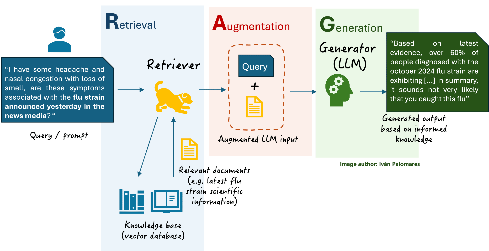

*Retrieval finds the documents that resemble the question; Augmentation adds them to the prompt; Generation produces an answer grounded in what was retrieved.*

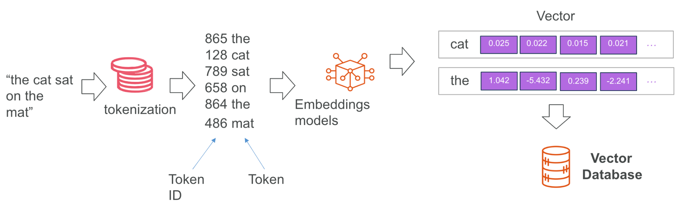

*Tokenization splits the text; an embedding model turns it into a vector stored in a vector database.*

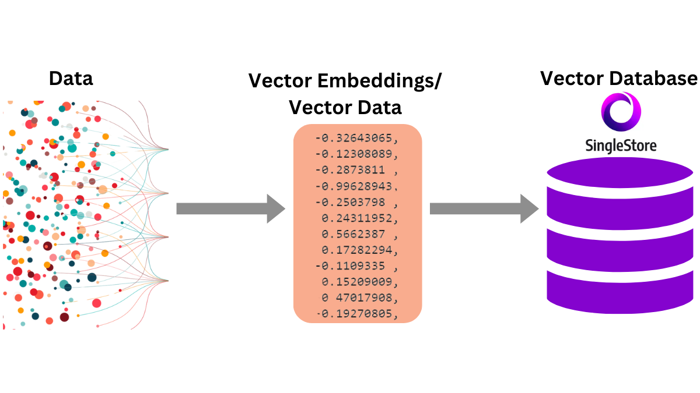

*A vector store holds the embeddings and returns the nearest matches to a query vector.*


### Lab 5 — RAG Customer Care Chatbot (Cook & Bake Academy)

Learning outcome: this lab develops your ability to deploy a RAG application that grounds an agent in the organisation's own documents (A1, A2, A3, K5, K7, K8).

Deck reference: Slides 108–114.

**Goal**

Cook & Bake Academy runs 20 courses across two campuses, and its two-person customer care team retypes the same answers all day. Every answer is already written in the course brochures. You build the full RAG loop: an ingestion workflow that embeds all 20 brochures into a vector store, and a chatbot that retrieves only the brochures resembling each question and answers strictly from those.

**What you'll build**

Ingestion: Drive → Split → Embed → Vector Store   ·   Answering: Webhook → Agent + Retriever → Respond   (Tools: n8n Simple Vector Store, Google Gemini Embeddings, Google Drive, AI Agent, Webhook.)

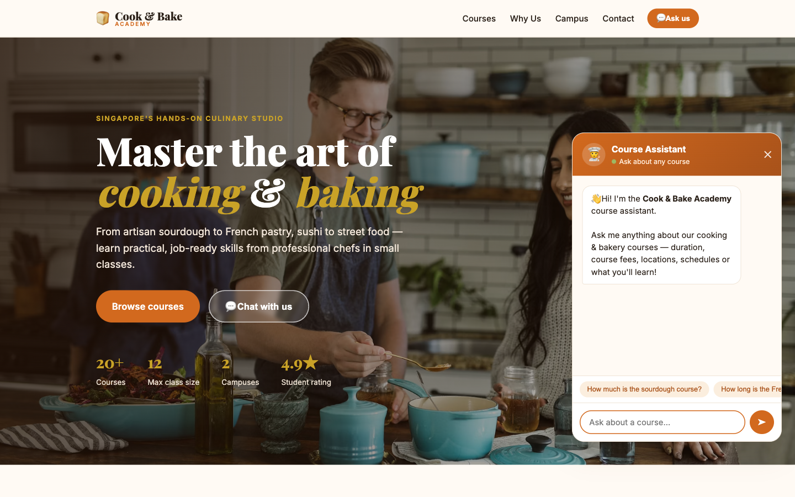

*The Cook & Bake Academy site with the course assistant open. Every answer it gives is grounded in the 20 brochures you ingested into the vector store.*

**The workflow on the n8n canvas**

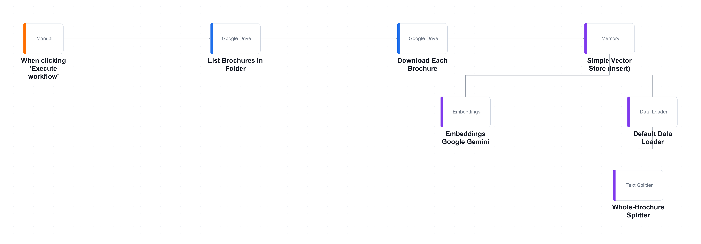

*The ingestion workflow on the n8n canvas — run ONCE by hand. Twenty brochures are listed, downloaded, split, embedded and inserted into the vector store.*

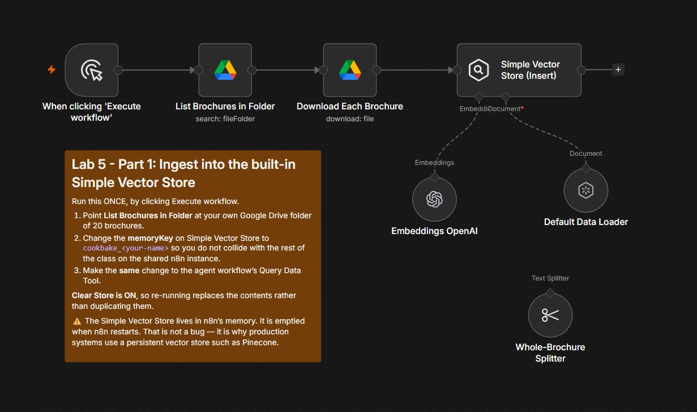

*Part 1 as it looks after import. You run it once, by hand, to load all 20 brochures into the vector store.*

| Part of the flow | What it does |
|---|---|
| Fetch the brochures | When clicking 'Execute workflow' starts the run. List Brochures in Folder finds the 20 files in YOUR Drive folder, and Download Each Brochure pulls each one down. |
| Split and embed | Default Data Loader reads each file, Whole-Brochure Splitter keeps one brochure as one chunk, and the Embeddings node turns every chunk into a vector. |
| Insert into the store | Simple Vector Store (Insert) saves the 20 vectors under your memory key, cookbake_<your-name>. Clear Store is ON, so a re-run replaces instead of duplicating. |

> **Note:** Ingestion is a batch job: re-run it when a brochure changes — and after every n8n restart.

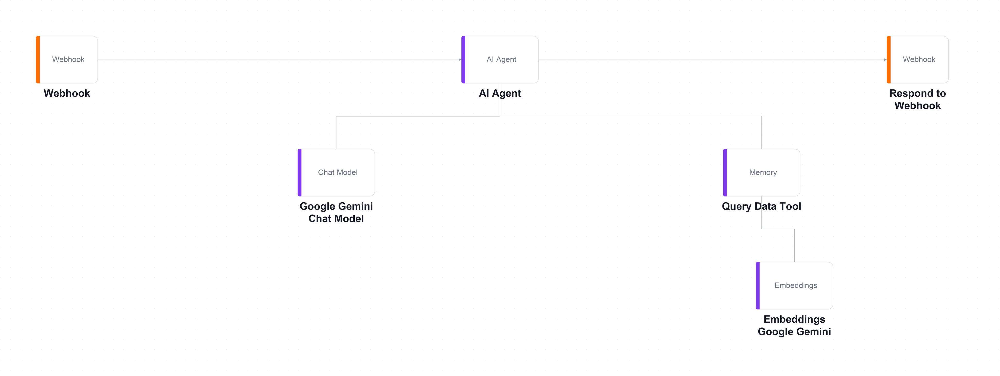

*The answering workflow on the n8n canvas — runs on EVERY question. The Query Data Tool and its embedding model hang below the agent.*

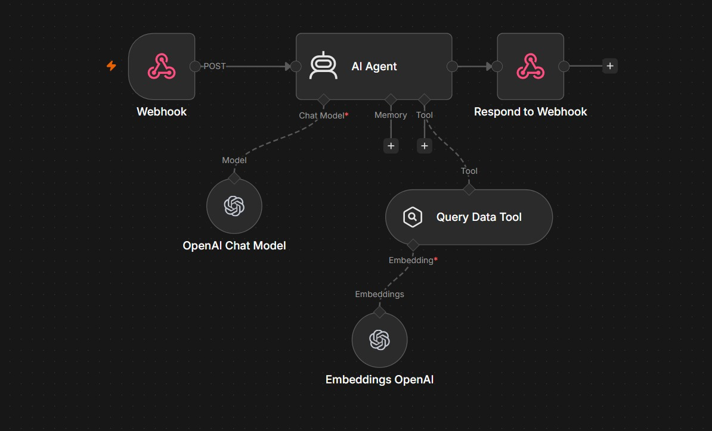

*Part 2 runs on every question. The agent must search the brochures before it is allowed to answer.*

| Part of the flow | What it does |
|---|---|
| Question in, answer out | Webhook receives the visitor's question from the website as a POST. Respond to Webhook sends the agent's reply back to the chat window. |
| The agent and its model | AI Agent reasons with the chat model. Its system message says: call the tool first and never invent a fee. No Memory is attached, so each question stands alone. |
| The retrieval tool | Query Data Tool searches YOUR memory key and returns the 5 closest brochures. Shown here with OpenAI; the lab file ships with Gemini — swap one, swap both. |

> **Note:** Same embedding model and same memory key in both workflows — or retrieval silently finds nothing.

**Key screens**

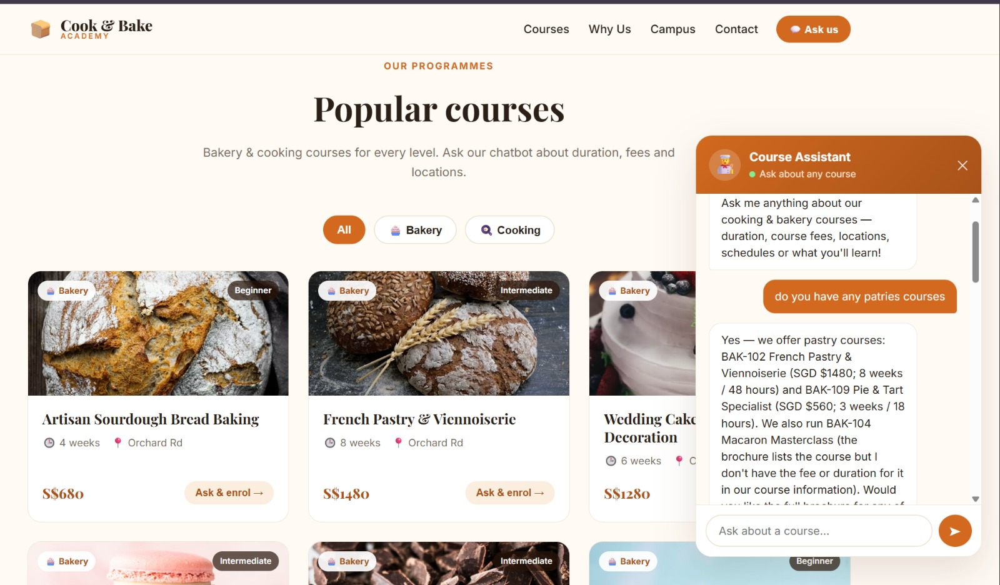

*The Course Assistant in Action. A real conversation on the Cook & Bake Academy site. Every fee in the reply came from a retrieved brochure.*

| What to notice | Why it matters |
|---|---|
| A typo still finds it | The visitor typed 'patries'. Embeddings match meaning, not spelling, so the pastry brochures BAK-102 and BAK-109 still come back. |
| Facts quoted, not invented | Fees and durations are quoted exactly: BAK-102 is SGD $1480 for 8 weeks / 48 hours — the same S$1480 shown on the course card behind the chat. |
| It admits a gap | It did not give BAK-104's fee and said so instead of guessing. The brochure does list SGD $420, so check what the tool returned: that is a retrieval gap. |

> **Note:** 'I don't have that' is grounding working — fix gaps in retrieval, never by loosening the prompt.

**Step-by-step**

1. In Google Drive create a folder named 'brochures' and upload all 20 .txt files from the lab's brochures/ folder.
   > *Why this step:* That folder becomes the academy's single source of truth. When a fee changes, it changes here and nowhere else.

2. Open one brochure and read it — everything the chatbot will ever say comes from files like this one.
   > *Why this step:* If a fact is not in these files, a correctly-grounded chatbot cannot say it. That is the point of RAG.

3. Import Lab 5 - Part 1 Ingest Brochures.json — this is the ingestion workflow you run once.
   > *Why this step:* Ingestion and answering are separate workflows: you ingest once, then answer thousands of questions.

4. Open List Brochures in Folder, select YOUR brochures folder, and set your Google Drive credential.
   > *Why this step:* Point it at your own folder, or you will be answering questions from the author's copy of the documents.

5. Open Simple Vector Store (Insert) and change the Memory Key from cookbake_brochures to cookbake_<your-name>, because the whole class shares one namespace.
   > *Why this step:* The memory key is a global namespace on a shared instance. Leave the default and you will be answering questions from each other's brochures.

6. Confirm Clear Store is ON so that re-running replaces the 20 brochures instead of storing them twice.
   > *Why this step:* Turn it off and run twice, and every search returns each brochure twice.

7. Open Whole-Brochure Splitter and note chunk size 4000 with overlap 0 — one brochure becomes exactly one vector, so the fee is never separated from the course name.
   > *Why this step:* The default 1000-character splitter would slice a brochure into three: the fragment mentioning sourdough would not be the fragment with the price.

8. Open Embeddings Google Gemini, select your credential, and note the model gemini-embedding-001 produces 3072-dimensional vectors.
   > *Why this step:* Remember this number. The store's dimension must equal the embedding model's output, and a mismatch is the top cause of failed inserts.

9. Click Execute workflow. Twenty files are listed, downloaded, embedded and stored in about thirty seconds.
   > *Why this step:* Confirm exactly twenty vectors were inserted. More than twenty means Clear Store was off and you have duplicates.

10. Import Lab 5 - Part 2 Cook and Bake RAG Chatbot.json — the answering agent.
   > *Why this step:* This is the half that runs on every question. It never sees nineteen of the twenty brochures.

11. Open Query Data Tool and set its Memory Key to the SAME cookbake_<your-name> you used during ingestion. A mismatch here is the most common failure in this lab.
   > *Why this step:* If the keys differ, the agent searches an empty store and answers 'I don't have that' to everything — with no error anywhere.

12. Confirm the retrieval Embeddings node uses the identical model to ingestion — a question embedded by one model cannot be compared against brochures embedded by another.
   > *Why this step:* The numbers mean different things between models. The comparison silently returns nonsense rather than failing.

13. Open AI Agent and read the grounding rules: always call the tool first, never invent a fee or an instructor, and say 'I don't have that in our course information' when the brochures are silent.
   > *Why this step:* An ungrounded model asked for a price will produce one. It will be plausible, it will be wrong, and the customer will quote it back to you.

14. Save, Activate, copy the Production URL, then serve the website folder and paste the URL into Lab configuration.

   ```bash
   python3 -m http.server 8000
   ```

   > *Why this step:* If the webhook is unset the page silently falls back to a local keyword search and looks like it works — watch for the yellow warning banner.

15. Click the chat button and ask 'How much is the sourdough course?', then work through all ten rows of sample-questions.csv.
   > *Why this step:* TC7, TC8 and TC9 each plant something false and invite the model to agree. Any confident answer is a failure, however fluent.


**Test it**

TC1 must quote BAK-101's exact fee from the brochure. Then run the three hallucination probes: TC7 (a course that does not exist), TC8 (an instructor name no brochure contains) and TC9 (a discount that was never offered). Any confident answer to these is a failure, however fluent.

**What you learned**

- What RAG does — RAG retrieves the few documents that resemble the question instead of pasting everything into the prompt.
- Embeddings — An embedding places similar meanings close together, so retrieval works even when no words match.
- Chunking — Chunking is the single biggest lever on RAG quality — the right chunk answers a question on its own.
- Match model and key — The ingestion and retrieval embedding models must be identical, and the memory keys must match.
- In-memory is temporary — n8n's Simple Vector Store is wiped when n8n restarts — fine for learning, unacceptable in production.

**Troubleshooting**

| Symptom | Cause and fix |
|---|---|
| Every answer is 'I don't have that in our course information' | The Memory Key on Query Data Tool does not match the one on Simple Vector Store (Insert). This is the number-one cause. |
| It worked, then stopped after lunch | n8n restarted and the in-memory store was wiped. Re-run the ingestion workflow. |
| Answers are correct but a yellow 'Offline demo answer' banner appears | The webhook is unset or unreachable. You are reading the page's local fallback, not your agent. |
| Every brochure appears twice in the results | Clear Store is off on the insert node and you ran the ingestion twice. |
| The agent quotes a fee that is in no brochure | It did not call the tool, or called it and ignored the result. Check the execution log — did course_brochures actually run? |
| Retrieval returns nothing sensible | The ingestion and retrieval Embeddings nodes use different models. They must be identical. |

> **Note:** The workflow file and all supporting assets for this lab are in labs/lab5-rag/.

---


## Taking This Back to Work

- Start with one painful process — repetitive, high-volume and low-risk. Automate that first.
- Map it before you build it: draw the trigger, the decisions and the actions on paper.
- Decide where the human belongs. Anything irreversible, regulated or expensive keeps an approval gate.
- Ground the agent in your own data. RAG over your policies and documents beats a general model.
- Log everything from day one — you will need the audit trail long before you think you will.
- Iterate with real cases, and test with the questions you fear rather than the ones you hope for.


## Glossary

- **Agentic AI** — AI that pursues a goal by planning, acting through tools, observing the result and adapting — rather than answering a prompt once.
- **AI Agent** — An LLM given a goal, a set of tools and memory, which decides which tool to call and when.
- **Action** — A node that does something — sends an email, appends a spreadsheet row, calls an API.
- **Trigger** — The first node in a workflow; it decides when the workflow runs.
- **Webhook** — A URL that an external system POSTs to in order to start your workflow.
- **CORS** — Cross-Origin Resource Sharing — the browser rule that decides whether a page may read a response from another host.
- **Expression** — n8n syntax for reading data from an earlier node, e.g. {{ $json.Name }}.
- **System instruction** — The agent's role, scope, prohibitions and routing rules; the main control surface for behaviour.
- **Memory** — Conversation context kept across turns, keyed on a session ID.
- **Tool** — A capability attached to an agent — a spreadsheet lookup, a vector search, an email send, an API call.
- **Structured output** — Forcing the agent to return named fields instead of prose, so downstream nodes can branch on them.
- **Human in the loop** — A step that pauses the workflow until a named person approves or declines the proposed action.
- **RAG** — Retrieval-Augmented Generation — retrieving the documents that resemble a question and answering only from those.
- **Embedding** — A vector representation of text, positioned so that similar meanings land close together.
- **Chunking** — Splitting documents before embedding; the right chunk is the smallest text that still answers a question on its own.
- **Vector store** — A database that stores embeddings and finds the nearest neighbours to a query vector.
- **topK** — How many of the nearest chunks are retrieved and given to the model.
- **Hallucination** — A fluent, confident answer that is not grounded in any source — what grounding rules exist to prevent.
